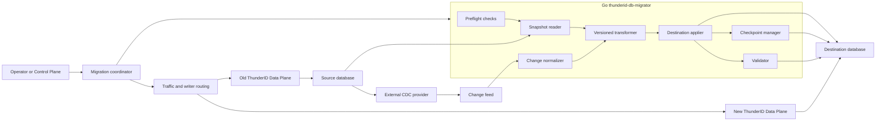
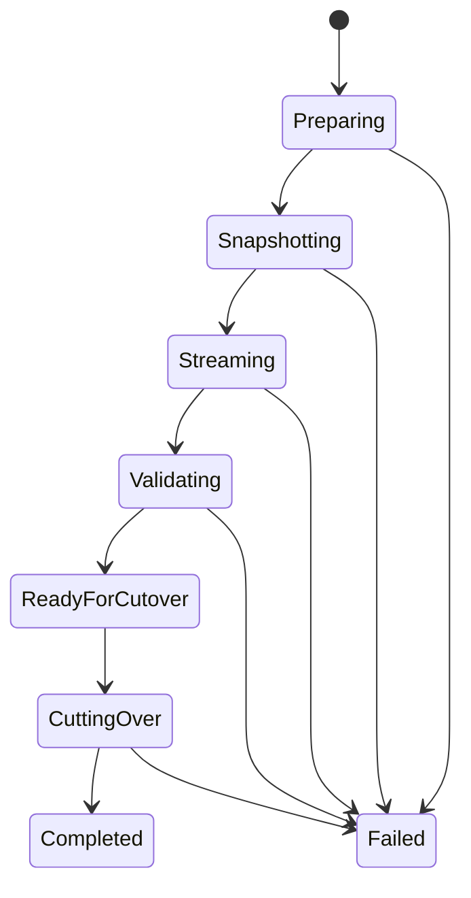
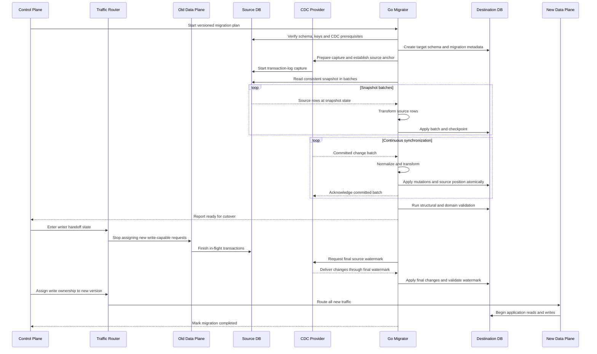

# Recommended CDC database-copy migration approach

## Status

This document proposes a ThunderID architecture for zero-downtime database-copy migrations using
change-data capture. It defines component boundaries and correctness requirements. It is not an
implementation commitment or a replacement for a migration plan for a specific release.

The production scope includes PostgreSQL and the planned MySQL, Microsoft SQL Server and Oracle
Database providers. SQLite is outside the production zero-downtime migration scope.

## Decision summary

The recommended approach is:

1. Keep ThunderID and all ThunderID-owned migration code in Go.
2. Implement migration as a separate `thunderid-db-migrator` executable, not in the request-serving
   server process.
3. Make snapshot coordination, transformation, destination application, validation and cutover
   native capabilities of this executable.
4. Define a provider-neutral, out-of-process CDC contract for transaction-log capture.
5. Use an existing external CDC implementation or managed database service behind that contract.
6. Do not implement PostgreSQL WAL, MySQL binlog, SQL Server transaction-log and Oracle redo-log
   readers inside ThunderID initially.
7. Use at-least-once change delivery with idempotent destination application.
8. Keep the source database as the only application write authority until an explicit cutover.
9. Use database-copy migration only when an in-place migration is unsafe or incompatible. Keep
   in-place migration as the simpler path for additive, backward-compatible changes.

Debezium is not embedded in ThunderID and is not required by this design. It can be one optional
external CDC provider when an operator permits a separately deployed Java service. An environment
that prohibits Java entirely must use another CDC provider or a future Go provider adapter.

## Goals

- Continue login and token traffic while a destination database is prepared.
- Preserve every committed mutation after the migration snapshot.
- Support schema and data transformations between ThunderID versions.
- Keep provider-specific transaction-log concerns outside ThunderID domain code.
- Support migration of one logical store without requiring all stores to move together.
- Make migration restartable, observable and safe to abort before cutover.
- Prevent stale or reordered data from weakening authentication or authorization decisions.

## Non-goals

- Providing a general-purpose CDC product.
- Implementing bidirectional multi-primary replication.
- Supporting production zero-downtime migration for SQLite.
- Automatically transforming arbitrary customer database customizations.
- Guaranteeing immediate rollback to the source after the destination accepts new writes.
- Running destructive source DDL while CDC is active.

## High-level architecture



The migration coordinator belongs to the control-plane side of the architecture. The old Data Plane
continues serving requests from the source database while the migrator prepares the destination.
The migration components are not placed in the authentication request path.

## Component responsibilities

### Migration coordinator

The coordinator owns the migration run and its state machine:



It records the source and target versions, logical store, deployment scope, provider configuration,
progress, validation status and cutover state. It must not depend exclusively on the physical
database that is being replaced.

### Source preflight checker

Before snapshotting, the migrator verifies:

- the source and destination versions match the migration plan;
- CDC or logical replication is enabled and reachable;
- the CDC identity has the required least-privilege access;
- transaction logs are retained for the expected migration duration;
- captured tables have stable keys for update and delete application;
- required before-images or equivalent source data are available;
- destination capacity is sufficient;
- source DDL and incompatible configuration changes can be fenced; and
- no other migration owns the same logical store and deployment scope.

A failed preflight prevents the migration from starting.

### CDC provider

The CDC provider is a separate process or managed service. It owns database-specific behavior:

- PostgreSQL logical replication and WAL positions;
- MySQL row-based binlog positions or GTIDs;
- SQL Server CDC and log sequence numbers; and
- Oracle redo-log capture through the selected supported mechanism.

The provider establishes the snapshot anchor, captures committed changes in source order, persists
its source offset and resumes after restart. It exposes changes to the Go migrator through a
versioned transport contract.

ThunderID should initially integrate providers out of process rather than maintaining four native
log readers. A future Go implementation can satisfy the same contract without changing migration
plans or transformers.

### Snapshot reader

The snapshot reader copies the source baseline in bounded batches. It uses a source position that is
coordinated with CDC so every mutation belongs to either the snapshot state or the subsequent change
stream.

The provider may supply an integrated snapshot. Otherwise, it must supply an anchor that allows the
migrator to take a consistent database snapshot and then consume changes from the corresponding
position without a gap.

Snapshot batches are restartable and carry stable table and key boundaries. They are transformed
through the same versioned transformation rules used for streamed changes.

### Change feed

The baseline design does not require Kafka. A CDC provider may deliver acknowledged batches directly
to the migrator over a secured HTTP or gRPC interface while the source log and persisted provider
offset act as the durable replay source.

A durable broker is an optional deployment profile for migrations that require deeper buffering,
independent scaling or extended replay. The transport choice does not change the internal change
contract.

The migrator acknowledges a delivered batch only after destination mutations and the destination
checkpoint commit successfully.

### Change normalizer

Provider-specific events are normalized into a common internal record:

```text
ChangeRecord
  migration ID
  source provider and database
  source position
  transaction ID
  order within transaction
  schema and table
  operation
  primary key
  before values
  after values
  source schema metadata
  source commit time
```

`DEPLOYMENT_ID` remains part of the ThunderID row data. It must be preserved and validated. For
deletes, the provider must expose enough key or before-image information to determine deployment
scope and the destination records to remove.

### Versioned transformer

The transformer converts a source-version row change into one or more destination mutations:

```text
source row or change
        |
        v
source-version to target-version transformer
        |
        v
ordered destination mutations
```

Migration plans bind transformations to a source version, target version and logical store. The same
rules process snapshot rows and CDC events so the two paths cannot create different representations.

Declarative rules are appropriate for simple operations such as renames, copies, defaults, casts and
filters. Version-specific Go code handles table splits, table merges, derived state and ThunderID
domain rules.

A transformation failure is not skipped. It stops progress for the affected transaction and blocks
cutover until resolved.

### Destination applier and checkpoint manager

The applier writes transformed mutations using destination-provider SQL. It preserves required
transaction boundaries, record order and foreign-key dependencies.

Delivery is at least once. Destination application must therefore be idempotent. The preferred
commit boundary is:

```text
begin destination transaction
  apply transformed mutations
  record the applied source position
commit destination transaction
acknowledge the CDC batch
```

Storing the applied position in the same transaction prevents a committed mutation from being
separated from its checkpoint. The checkpoint record is migration metadata scoped by migration ID,
logical store and `DEPLOYMENT_ID` where applicable.

### Validator

Validation runs before cutover and checks more than CDC lag. It includes:

- deployment-scoped row and key coverage;
- checksums for data that should remain unchanged;
- foreign-key and uniqueness constraints;
- delete propagation;
- transformer-specific invariants;
- authentication and authorization data consistency; and
- security-critical state such as suspension and lock status.

Reaching zero CDC lag is necessary but does not prove that transformation logic is correct.

### Traffic and writer-routing coordinator

Before cutover, the old Data Plane is the only application writer. The destination is writable only
by the migrator. At cutover, a routing epoch or writer lease transfers ownership to the new Data
Plane and prevents both versions from accepting writes independently.

Requests arriving during the short handoff may wait or retry through the gateway. They must not be
rejected solely because ownership is moving.

## End-to-end migration sequence



## Correctness invariants

The migration cannot be considered safe unless all of these remain true:

1. The snapshot and CDC stream have no gap.
2. The source is the only application write authority before cutover.
3. The destination is modified only by the migrator before cutover.
4. Source transaction order is preserved wherever destination correctness depends on it.
5. Every applied source position is checkpointed atomically with its destination mutations.
6. Event replay is safe and does not create duplicates or regress state.
7. Deletes and expiry-driven removals are propagated when required.
8. No unresolved transformation error is skipped.
9. The destination is validated through the final source watermark.
10. The new Data Plane receives write ownership only after final catch-up.
11. Old and new Data Planes never independently accept writes for the same migration scope.
12. `DEPLOYMENT_ID` isolation is preserved throughout capture, transformation and application.

## ThunderID logical-store application

The migration plan is defined per logical store. A release does not need to copy databases whose
schema and data representation remain compatible.

| Logical store        | Recommended database-copy treatment                                                                                                                                                                                        |
| -------------------- | -------------------------------------------------------------------------------------------------------------------------------------------------------------------------------------------------------------------------- |
| `config`             | Prefer blocking configuration mutations and copying a stable snapshot. Use CDC only when configuration writes must continue throughout migration. Login-serving reads can remain on the source until cutover.              |
| `entitydb`           | Use CDC when login, provisioning, passkey or lifecycle operations can mutate entity data during migration. Treat lifecycle and credential state as security-critical validation targets.                                   |
| `runtime_transient`  | Use CDC when the destination must preserve in-flight authorization, flow, replay-prevention and CIBA state. Account for high churn, deletes and expiry. Reusing a compatible runtime store can be simpler than copying it. |
| `runtime_persistent` | Use CDC when SSO sessions, consent or revocation data can change during migration. Validate revocation and session state through the final watermark.                                                                      |

If only `entitydb` changes between releases, the migration plan should leave the other logical stores
connected as-is when their schemas remain compatible.

## Security-critical lifecycle data

Lifecycle data does not need a separate synchronization architecture. It uses the generic snapshot,
CDC, transformation and application pipeline. It does require stricter acceptance rules:

- a newer suspension cannot be replaced by a stale active state;
- a newer lock-until value cannot be replaced by an older value;
- missing or failed lifecycle changes block cutover;
- the final source watermark includes all completed login-time lifecycle transactions; and
- destination verification exercises active, suspended, locked and automatically unlocked cases.

Source transaction ordering and idempotent application should be used before adding a separate
lifecycle version column. Add domain-specific versions only when the generic ordering contract is
insufficient for the chosen transformation.

## Failure behavior

| Failure                                 | Required behavior                                                                                           |
| --------------------------------------- | ----------------------------------------------------------------------------------------------------------- |
| CDC provider unavailable                | Pause migration. Keep the old Data Plane serving from the source. Do not cut over.                          |
| Destination unavailable                 | Pause application and retain source changes through the CDC offset and source-log retention policy.         |
| Duplicate change delivery               | Reapply safely through idempotent destination mutations and checkpoint checks.                              |
| Transformer failure                     | Stop the affected transaction, expose the error and block cutover. Never skip the record silently.          |
| Validation failure                      | Keep the source authoritative and investigate or restart migration.                                         |
| Source log position expired             | Fail the run and take a new coordinated snapshot unless the provider offers another lossless recovery path. |
| Cutover fails before destination writes | Restore routing to the old Data Plane.                                                                      |
| Failure after destination writes begin  | Prefer roll-forward recovery. Returning to the source requires reverse synchronization.                     |

## Rollback boundary

Before cutover, aborting the migration is straightforward because the source remains authoritative.
The destination and CDC resources can be discarded after audit information is retained.

After the destination accepts its first application write, the source is stale. Immediate rollback
would lose new changes unless reverse CDC or a verified reverse transformation is already operating.
The recommended initial design treats the first destination write as the roll-forward boundary.

## CDC provider integration options

### Baseline: external provider contract

The supported ThunderID capability is the provider-neutral contract, not a particular CDC product.
An operator can connect a managed service, a database-vendor tool or another compatible executable.
This keeps transaction-log implementation and database-version certification outside ThunderID.

### Optional Debezium integration

Debezium can reduce provider-specific work because it supplies PostgreSQL, MySQL, SQL Server and
Oracle source connectors and emits similarly structured change events. Debezium Server can run as a
separate application and deliver events to an HTTP endpoint or a supported durable stream without
embedding Java code in ThunderID.

Debezium remains optional external infrastructure. ThunderID does not link its libraries, include
Java migration code or require Debezium in environments that prohibit Java services.

### Future native Go adapters

Native Go adapters may be added behind the same contract when their maintenance cost is justified.
Each adapter must pass common contract tests for snapshots, offsets, transactions, duplicates,
deletes, failover and source-version compatibility. Adding adapters should not change transformer or
cutover logic.

## Operational and security requirements

- Encrypt source, destination and change-feed connections.
- Use separate least-privilege identities for snapshot reads, CDC capture and destination writes.
- Do not log credentials or unredacted sensitive row payloads.
- Encrypt persisted offsets, schema history and buffered changes where they contain sensitive data.
- Size source-log retention for the snapshot duration, expected lag and recovery window.
- Monitor snapshot progress, captured position, applied position, lag, retries and failed records.
- Apply backpressure before memory or destination capacity is exhausted.
- Audit migration start, operator actions, validation, cutover and cleanup.
- Remove replication slots, publications and other CDC resources after the rollback window closes.

## Testing requirements

Each supported source provider and version pair needs tests for:

- snapshot consistency under concurrent writes;
- restart during snapshot and streaming;
- duplicate and out-of-order delivery attempts;
- destination failure after mutation but before acknowledgement;
- source failover and connection interruption;
- log-retention exhaustion;
- insert, update and delete transformations;
- multi-row transaction preservation;
- `DEPLOYMENT_ID` isolation;
- final-watermark cutover races;
- lifecycle, credential, session and revocation invariants where applicable; and
- representative data volume and CDC lag.

## When to choose this approach

Use database-copy migration with CDC when:

- old and new versions require incompatible database representations;
- the migration would hold unacceptable locks on the serving database;
- transformation load must be isolated from login traffic;
- the destination needs extensive validation before use; or
- migration duration makes a maintenance window unacceptable.

Prefer an in-place migration when changes are additive, backward-compatible, operationally bounded
and proven not to interfere with login-time writes. CDC database-copy migration provides stronger
isolation, but it has more components, provider prerequisites and cutover complexity.

## Open decisions

1. Which external CDC contract and transport should ThunderID support first?
2. Which production database provider is the first implementation target?
3. Is a direct acknowledged feed sufficient, or must the first version require a durable broker?
4. Where should coordinator state and destination-local checkpoints be stored?
5. Which component owns writer leases and traffic-routing epochs?
6. What maximum cutover latency is acceptable while new write requests wait?
7. Which logical stores and migration types are supported in the first release?
8. What source and destination database-version compatibility matrix is supported?
9. What is the post-cutover roll-forward and emergency rollback policy?

## References

- [Login-only mode current-state assessment](login-only-mode-current-state.md)
- [Debezium source connectors](https://debezium.io/documentation/reference/stable/connectors/index.html)
- [Debezium Server](https://debezium.io/documentation/reference/operations/debezium-server.html)
- [Debezium PostgreSQL connector](https://debezium.io/documentation/reference/stable/connectors/postgresql.html)
- [Debezium MySQL connector](https://debezium.io/documentation/reference/stable/connectors/mysql.html)
