# Design - Version upgrades in ThunderID

Meeting review draft, version 0.4. This summarizes our working design, not an approved specification
or an implemented migration feature. Proposed commands and examples are illustrative. Read sections
1, 3 and 4 for the presentation; the remaining sections capture rationale, risks and review coverage.

Companions: [requirements](migration-requirements.md), [detailed decisions](migration-design-decisions.md),
[feature brief](migration-feature-brief.md), feature issue #5208 and discussion #5271.

### Diagram reading guide

Use the diagrams as the main explanation. Short notes define scope and exceptions, not a second
walkthrough. All version examples assume adjacent published releases. Diagrams marked **open detail**
show agreed boundaries but deliberately leave an unfinished procedure unspecified.

For the meeting, follow **[F02](#f02-startup-succeeds-or-terminates-before-runtime-initialization), [F03](#f03-sqlite-and-postgresql-use-the-same-fresh-initialization-path), [F20](#f20-normal-adjacent-release-upgrade-from-the-administrators-perspective), [F07](#f07-successful-global-execution-with-independent-store-finalization), [F14](#f14-partial-multi-store-success-blocks-startup-but-supports-resume), [F19](#f19-administrator-updates-configuration-and-declarative-files-manually), [F23](#f23-handled-failure-or-graceful-cancellation-followed-by-resume) and [F27](#f27-progress-retention-depends-on-migration-and-report-outcomes)**. The other diagrams answer
follow-up questions. Sequence participants are conceptual roles, not necessarily separate executables.

| Area | Diagrams | Location |
|---|---|---|
| Release authority and startup | [F01](#f01-release-authority-is-embedded-not-read-from-a-deployment-file) embedding; [F02](#f02-startup-succeeds-or-terminates-before-runtime-initialization) startup success/refusal | 4.1 |
| Fresh and legacy databases | [F03](#f03-sqlite-and-postgresql-use-the-same-fresh-initialization-path) common initialization; [F04](#f04-initialize-is-repeatable-but-does-not-hide-damaged-metadata) repeated initialization; [F05](#f05-register-fixed-legacy-baseline-before-applying-migration) legacy registration; [F06](#f06-metadata-installation-succeeds-in-only-some-namespaces) partial installation | 4.2 |
| Engine behavior | [F07](#f07-successful-global-execution-with-independent-store-finalization) execution; [F08](#f08-a-dependent-check-is-deferred-not-failed-or-falsely-passed) dependency checks; [F09](#f09-sql-and-programmatic-operations-use-the-same-scope-lifecycle) SQL/Go operations; [F10](#f10-atomic-scope-succeeds-or-rolls-back-as-one-unit) atomic execution; [F11](#f11-checkpointed-batches-retain-committed-work-after-a-failure) checkpoints; [F12](#f12-resume-reconciles-observed-data-with-durable-progress) resume decisions; [F13](#f13-deployment-scoped-work-completes-for-every-affected-deployment) deployments; [F14](#f14-partial-multi-store-success-blocks-startup-but-supports-resume) partial multi-store success; [F15](#f15-competing-engines-cannot-both-reserve-the-same-store) competing engines; [F16](#f16-reservation-fails-before-the-first-operation-starts) partial reservation | 4.3 |
| Administrator workflows | [F17](#f17-status-reports-recorded-state-and-exact-release-guidance) status; [F18](#f18-check-separates-database-readiness-from-file-validation-and-manual-review) check; [F19](#f19-administrator-updates-configuration-and-declarative-files-manually) manual file changes; [F20](#f20-normal-adjacent-release-upgrade-from-the-administrators-perspective) normal upgrade; [F21](#f21-a-release-has-no-database-migrations) no database changes; [F22](#f22-walk-several-published-releases-with-each-targets-own-artifact) multiple releases | 4.4 |
| Recovery | [F23](#f23-handled-failure-or-graceful-cancellation-followed-by-resume) handled failure; [F24](#f24-abrupt-interruption-requires-explicit-recovery-before-resume) stranded executor; [F25](#f25-restoration-and-abandon-are-not-automatic-rollback) restoration/abandon; [F26](#f26-data-reached-target-but-store-finalization-failed) finalization retry | 4.5 |
| Reporting | [F27](#f27-progress-retention-depends-on-migration-and-report-outcomes) progress retention; [F28](#f28-report-delivery-fails-after-migration-completes) report failure/retry; [F29](#f29-cleanup-fails-after-the-final-report-was-delivered) cleanup failure; [F30](#f30-json-result-output-does-not-replace-the-human-readable-report) JSON routing | 4.6 |
| Implementation and physical layouts | [F31](#f31-developer-changes-become-a-validated-release-artifact) developer/release workflow; [F32](#71---f32-logical-stores-share-one-physical-sql-namespace) shared namespace; [F33](#72---f33-logical-stores-use-separate-physical-sql-namespaces) separate namespaces | 4.7, 7 |
| Operation code and engine connections | [F34](#f34-release-operations-are-adapted-to-one-engine-contract) registration; [F35](#f35-the-engine-supplies-capabilities-and-owns-metadata) ownership; [F36](#f36-sql-operation-hooks-and-engine-execution) SQL hooks; [F37](#f37-programmatic-hooks-and-transaction-bound-execution) programmatic hooks | 4.8 |

## 1 - Summary

ThunderID upgrades have two distinct parts: the administrator replaces the software, and the target
release's migration mode brings existing databases to the levels required by that software. Normal
startup only checks compatibility and terminates before initializing ordinary services if any
configured relational store is incompatible, incomplete or unverifiable. It never applies migration.

The approach is one versioned executable with isolated serving, bootstrap and migration modes. Each
release embeds its own compatibility manifest and ordered migration plan for the immediately
preceding published release. Database-side records independently prove what each store completed.

**New surface:**

1. An embedded release manifest and an informational distribution copy.
2. A migration subsystem: shared contracts, engine, version-specific release packages and a current-release binding.
3. A mandatory read-only compatibility gate before serving or bootstrap service initialization.
4. `MIGRATION_STATE` and `MIGRATION_PROGRESS` metadata tables in each participating SQL namespace.
5. A `migration` command group and thin `migrate.sh` and `migrate.ps1` wrappers.
6. SQL and programmatic operation contracts, scope verification and checkpoint handling.
7. Human-readable and JSON results, report delivery and successful-run progress cleanup.
8. Lightweight release notices and release-specific migration documentation.

Existing database drivers, configuration loading, query clients and transaction machinery are reused
through migration-scoped integration. Setup, startup, build and test paths need wiring changes.
No new HTTP endpoint, frontend UI or mandatory third-party migration framework is proposed.

## 2 - Out of scope

- Redis migration is deferred. PostgreSQL and SQLite are the initial providers, including relational
  `runtime_transient` stores. Redis runtime and cache support are not removed. Redis representation
  changes need disclosed administrator guidance until a later phase provides migration support.
- Administrator configuration and declarative-resource files are not rewritten. Release notices and
  existing validators provide information; the administrator performs manual updates (R16, R17).
- Universal rollback and successful down-migration are not provided. Recovery is verified resume or
  restoration of a suitable backup (R14).
- One latest binary does not migrate every historical version in one operation. Upgrade orchestration
  walks adjacent published releases using each target release's artifact (R8, R22).
- Pre-v1.0.0 upgrades, API/SDK contract migration, and administrator secrets/key-file migration remain
  outside this feature's scope. Selected cryptographic database transformations may still require a
  programmatic operation.

## 3 - Architecture

The diagram shows proposed integration, not an existing migration implementation.

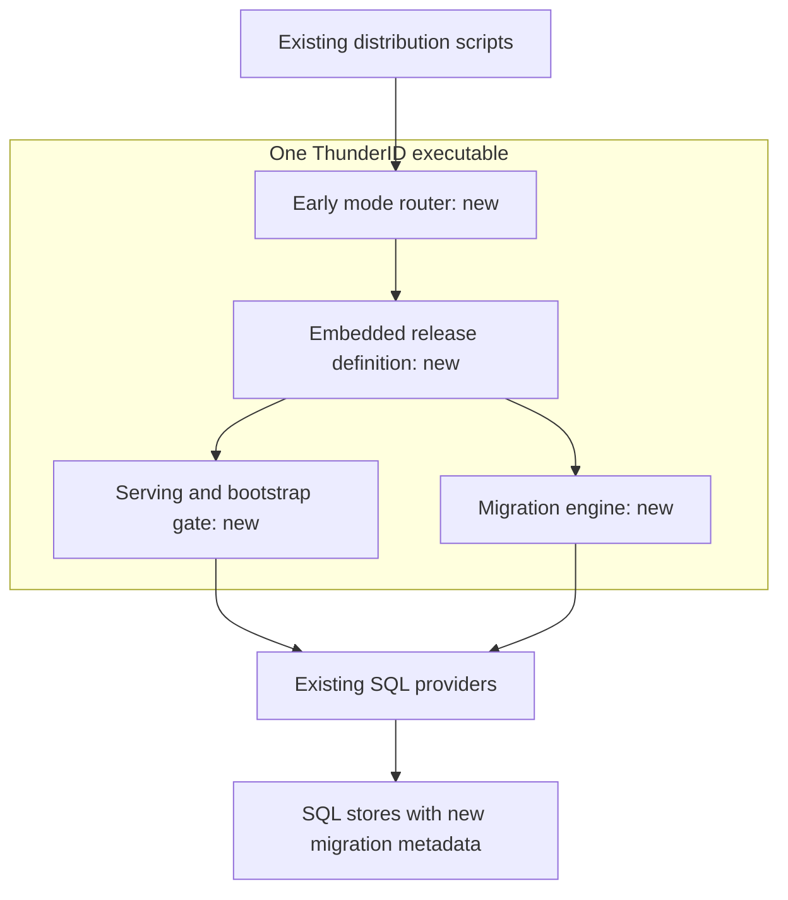

The gate reads authoritative state. The engine verifies and changes state. Only compatible serving
and bootstrap invocations proceed into their ordinary or selected service initialization.

### 3.1 - End-to-end reading route

F20 shows the administrator's normal upgrade. F07 expands what apply does. F14 explains why partial
multi-store success cannot enable startup. F23 and F24 distinguish resume from explicit recovery.
F27 explains when progress may be removed. These diagrams replace a prose-only walkthrough.

## 4 - Design

### 4.1 - Binary-to-database compatibility (R5, R6, R19)

The canonical JSON manifest declares the release version, accepted adjacent source release, metadata
format and per-store accepted source and required levels. Go's standard-library `embed` package packs
it into the binary. A readable copy is shipped but never used as runtime authority.

A store's completed level is the last release that changed that store, not necessarily the current
product version. Patch, minor and major releases can all carry migrations. Unchanged stores retain
their levels.

#### F01: Release authority is embedded, not read from a deployment file

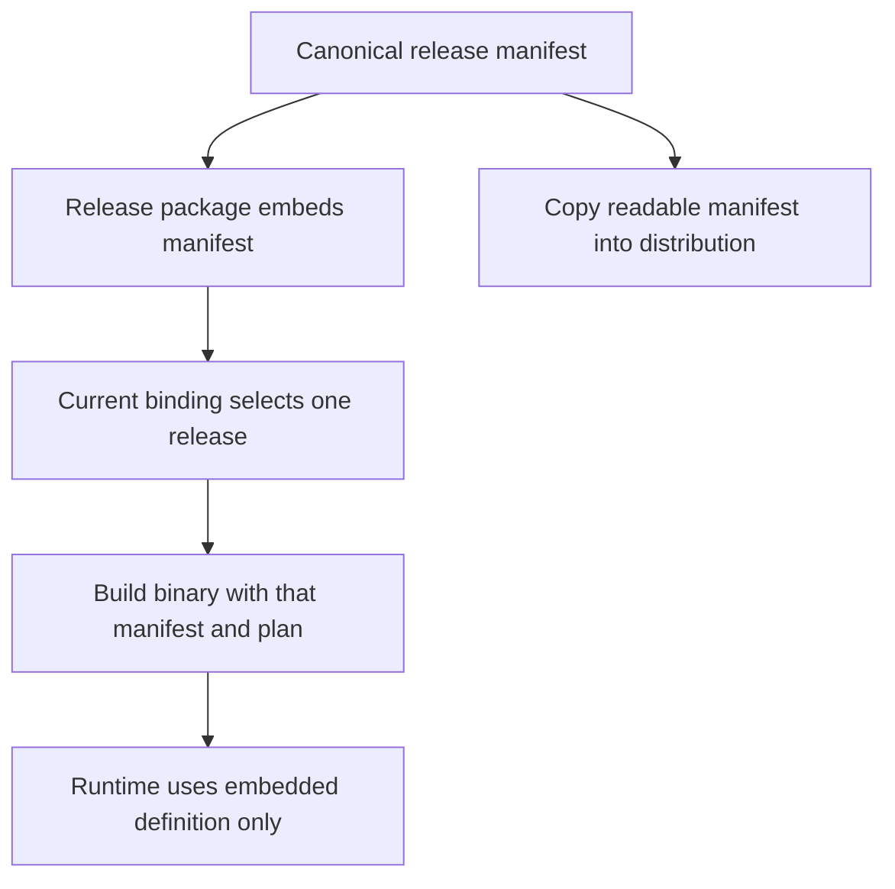

The copied file is informational. Editing it cannot change compatibility requirements or execution.
Build validation rejects inconsistencies between the release version, manifest and compiled plan.

Hypothetical store-level example:

| Store | Required by binary 1.0.0 | Required by binary 1.1.0 |
|---|---|---|
| `config` | 1.0.0 | 1.0.0, unchanged |
| `entity` | 1.0.0 | 1.1.0 |
| `runtime_transient` | 1.0.0 | 1.1.0 |
| `runtime_persistent` | 1.0.0 | 1.0.0, unchanged |

#### F02: Startup succeeds or terminates before runtime initialization

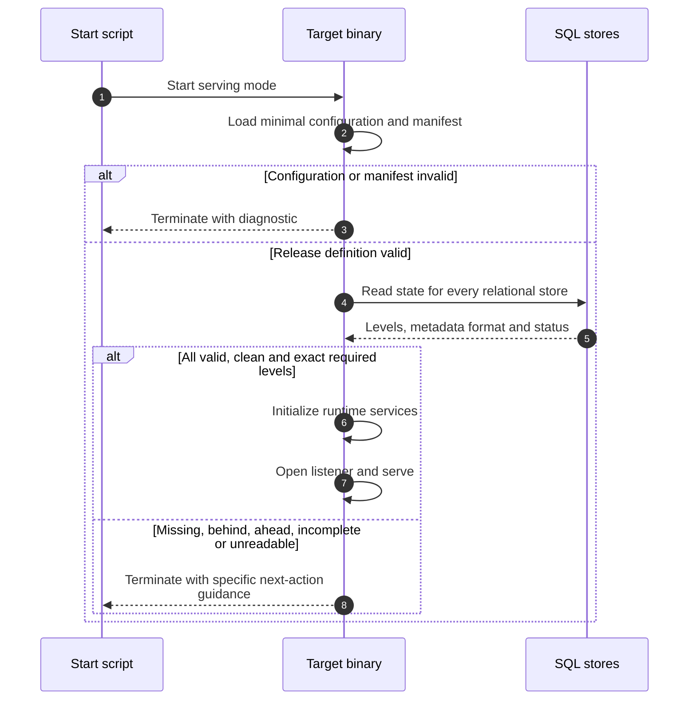

No gate branch writes data. The gate trusts established state rather than rescanning all application
content. Bootstrap also passes the gate first. Migration commands use action-specific validation,
not the serving gate. Existing seam: [main.go](backend/cmd/server/main.go).

### 4.2 - Trust-based initialization (R7, R25)

#### F03: SQLite and PostgreSQL use the same fresh-initialization path

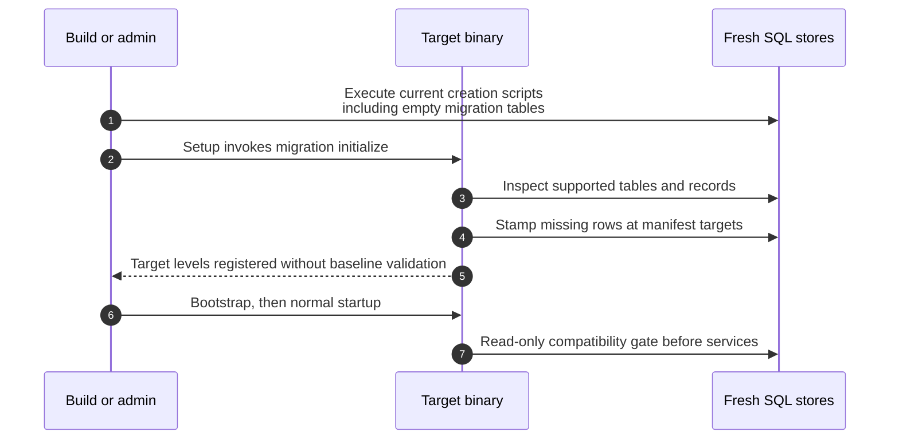

Packaged SQLite files are built from the scripts; PostgreSQL administrators execute their scripts.
Both use setup initialization. This relies on correct fresh-creation inputs, not baseline verification.

#### F04: Initialize is repeatable but does not hide damaged metadata

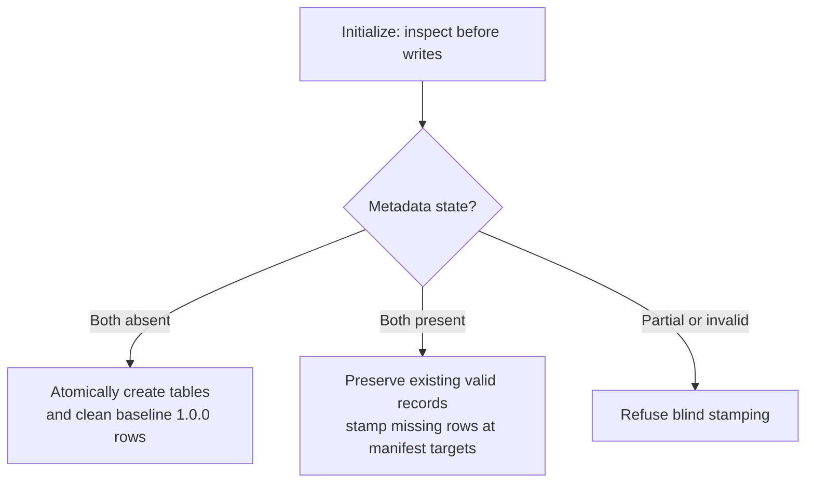

All missing baseline rows commit with table creation per namespace. Existing rows, including failed
or older-level rows, are never reset. Table existence routes registration but is not schema proof.

#### F05: Register fixed legacy baseline before applying migration

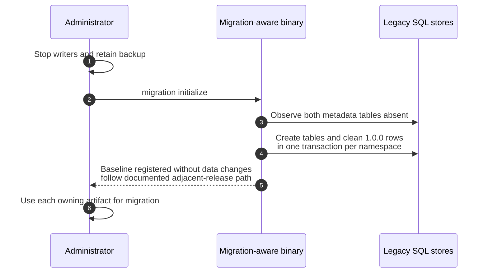

Absent metadata is assumed to represent the fixed 1.0.0 baseline. This is a deliberate trust-based
policy, not detected history. Later binaries may register that baseline but do not execute earlier
hops. Administrators must not remove/create/empty metadata to falsely authorize startup.

#### F06: Metadata installation succeeds in only some namespaces

Cross-database installation is not atomic. Initialization is retryable per namespace.

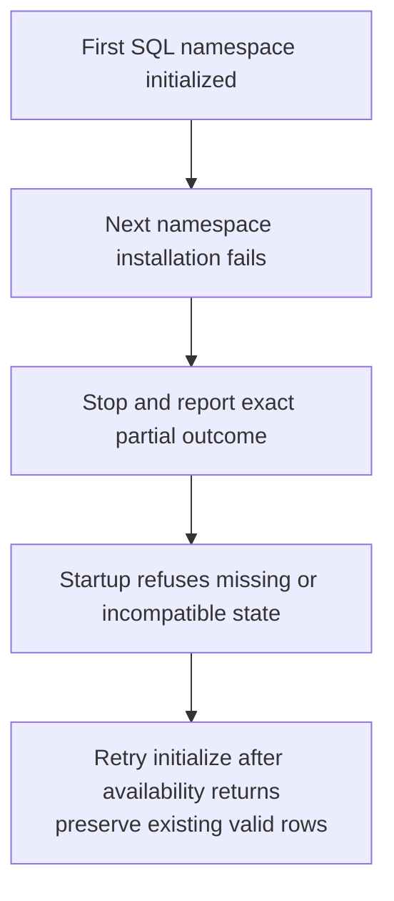

Do not infer success for remaining namespaces or overwrite existing rows. Table creation and all
required rows commit together within each namespace, so a failed namespace can be retried.

Existing seams: [build.sh](build.sh), [setup.sh](setup.sh),
[bootstrap orchestrator](backend/internal/system/bootstrap/orchestrator.go).

### 4.3 - Ordered migration execution (R1, R4, R8, R10, R15, R23, R24)

The target artifact contains one explicit global operation list for its accepted adjacent release.
One release can change multiple stores. Each operation has one writable store, declared read access,
a stable identifier, scope and interruption mode. Cross-store changes are decomposed into ordered
operations; execution is not inferred from filenames or discovered SQL scripts.

- `SQLOperation`: typed Go SQL definitions with explicitly ordered statements and implementations for
  each supported provider. Schema creation scripts remain a separate fresh-install path.
- `ProgrammaticOperation`: compiled migration-specific behavior for complex transformations or
  batching. It receives only selected migration-scoped dependencies, not the full serving graph.
- `CheckReadiness`: plan-wide read-only checks, returning ready, deferred or blocked. A dependency on
  an earlier operation can justify deferral, but deferred verification is never presented as passed.
- `PreVerify` and `PostVerify`: exact developer-authored checks around each operation scope.

#### F07: Successful global execution with independent store finalization

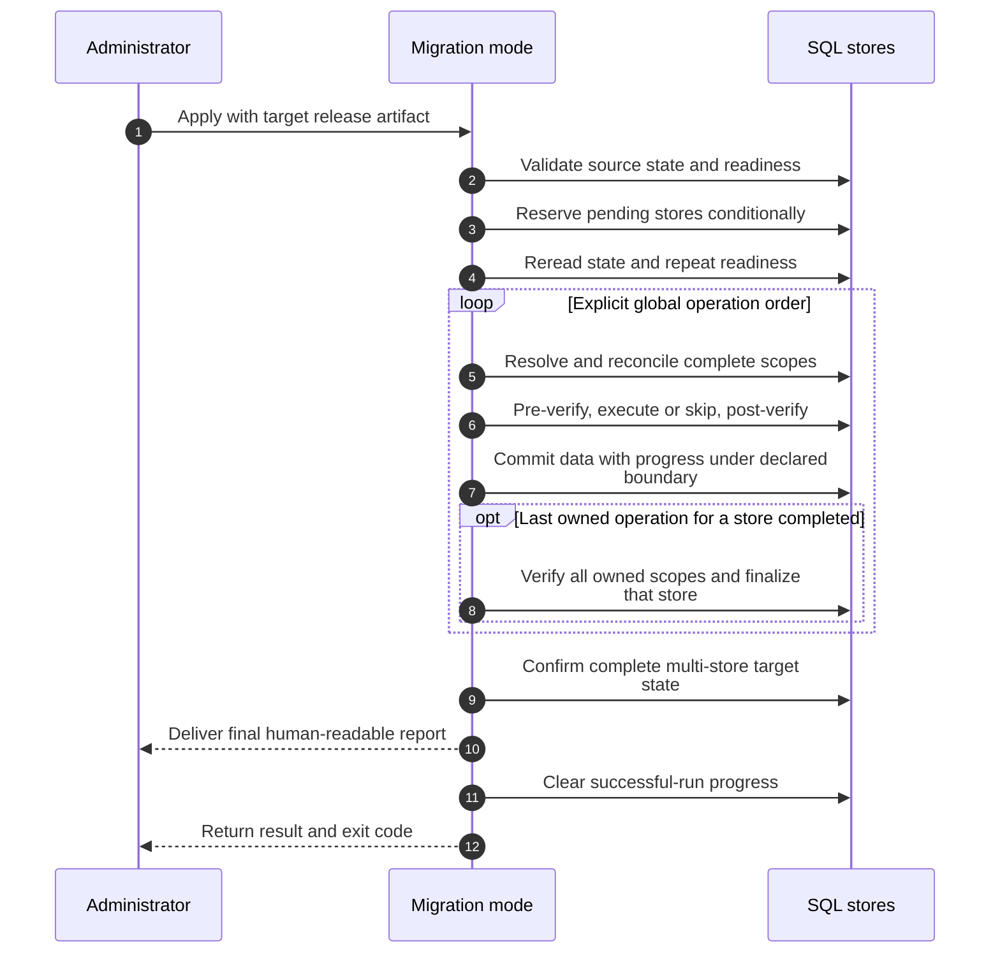

Scope transaction boundaries are expanded in F10 and F11. An operation cannot advance its store's
level itself. The first failure stops global execution; no reordering by store or operation kind occurs.

#### F08: A dependent check is deferred, not failed or falsely passed

Example: operation A adds a column; operation B fills it. `PlanContext` supplies preceding operation
identifiers, not simulated data or execution access.

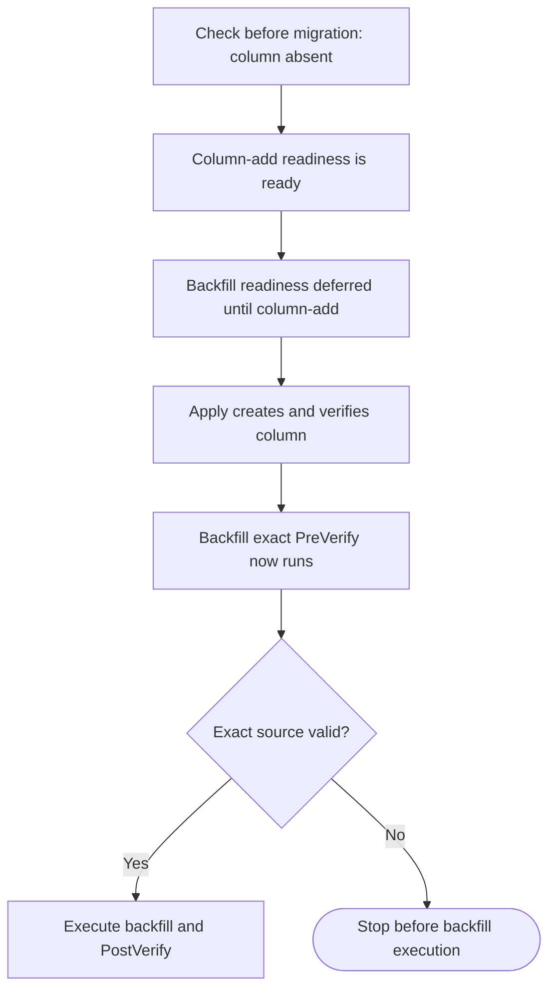

`CheckReadiness` is required. Only dependencies on validated preceding operations justify deferral.

#### F09: SQL and programmatic operations use the same scope lifecycle

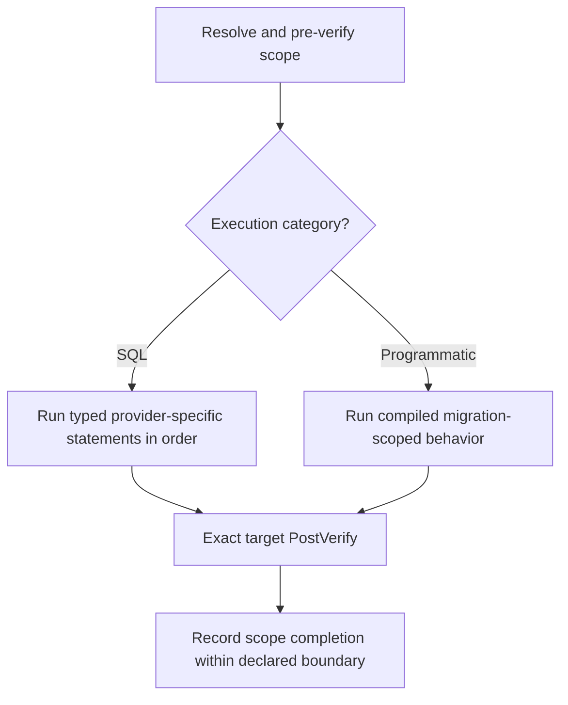

Already verified target scopes are skipped. No external SQL-file discovery or full serving graph is
used. Resumable checkpoints can commit before final scope completion; F11 shows that distinction.

#### F10: Atomic scope succeeds or rolls back as one unit

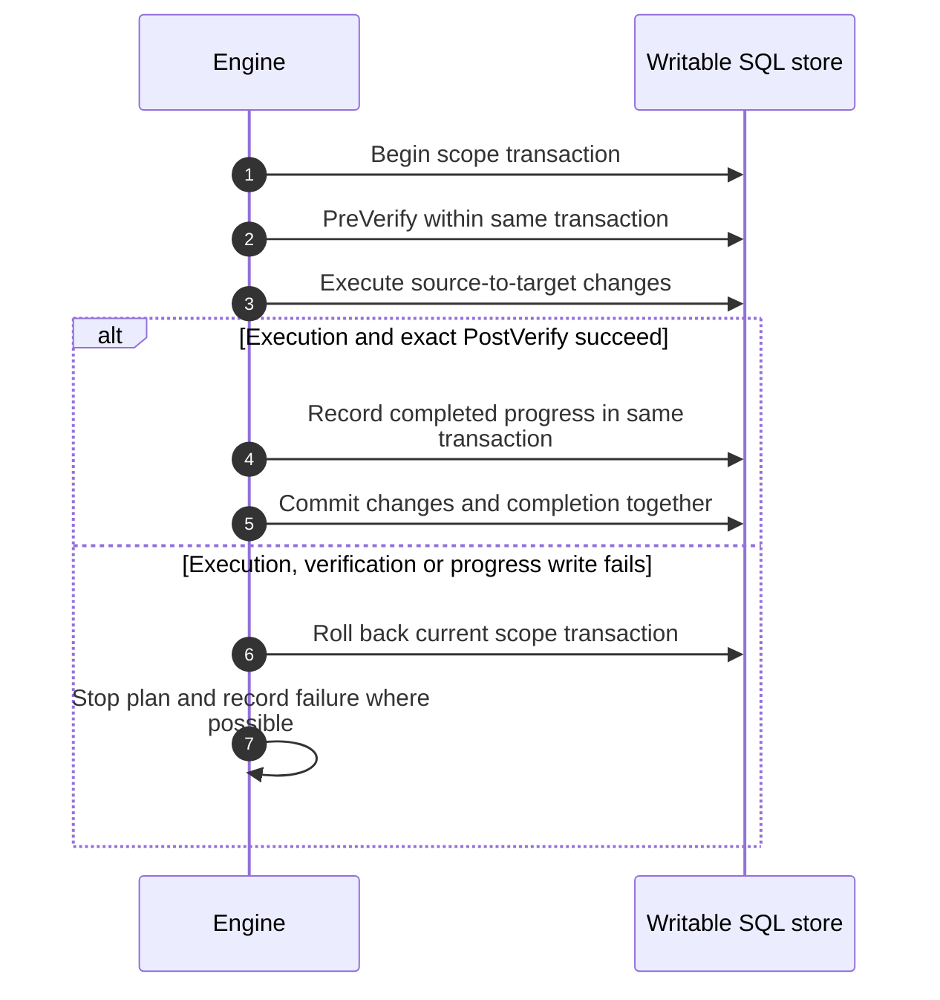

This shows a scope verified at source. Providers must support the declared transaction boundary.
Atomicity is not promised across scopes, stores or physical databases.

#### F11: Checkpointed batches retain committed work after a failure

Hypothetical cursors illustrate the contract, not a prescribed checkpoint schema.

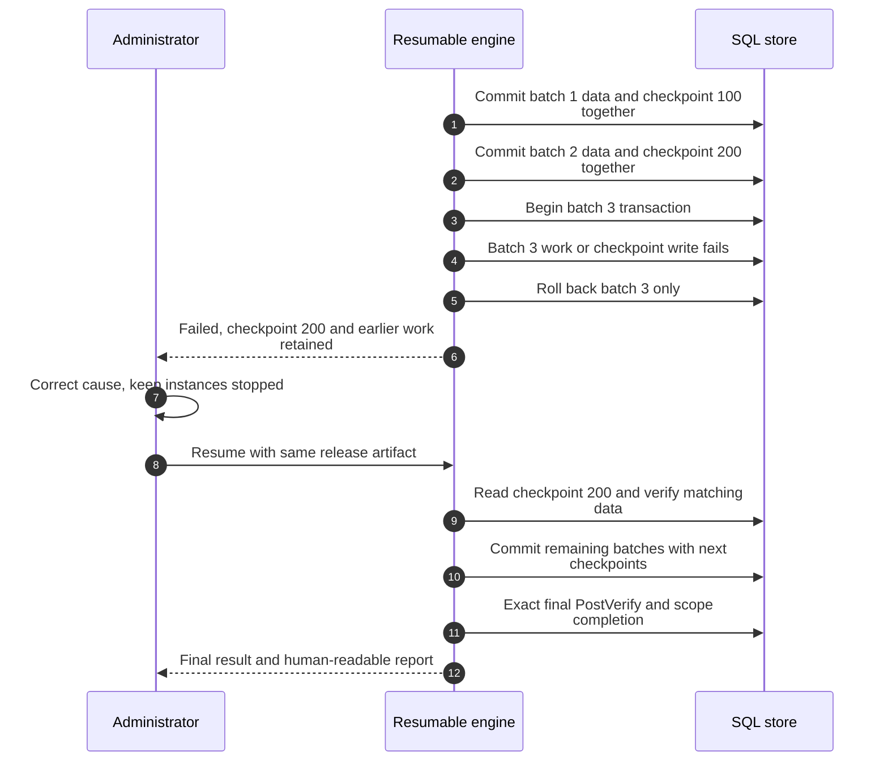

The engine owns each data/checkpoint transaction. A checkpoint is not proof of final completion.
Irreversible external side effects are not permitted by this initial resumable contract. F27 governs
cleanup after the entire run, not after this scope alone.

#### F12: Resume reconciles observed data with durable progress

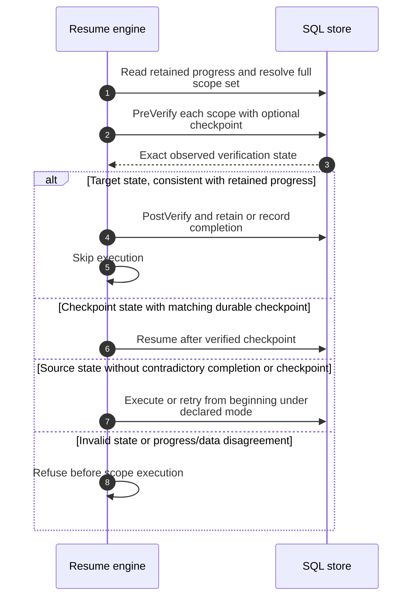

Completed progress requires exact target data. A durable checkpoint paired with pristine source data
is a disagreement, not permission to restart. Resume walks the plan from the beginning and reconciles;
it does not jump blindly to the recorded current operation.

#### F13: Deployment-scoped work completes for every affected deployment

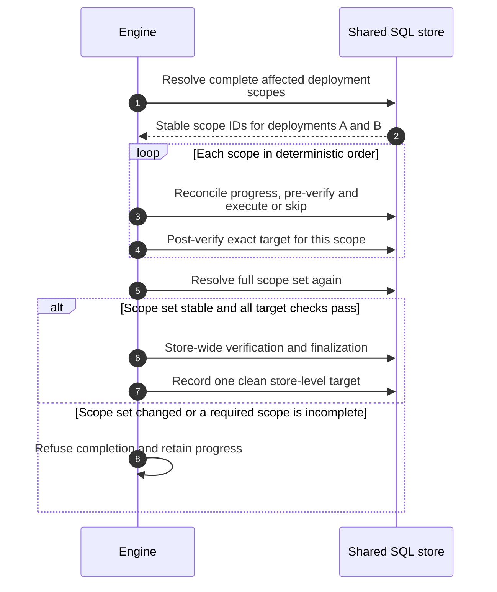

The engine discovers scopes from affected data, not only the configured deployment. It never changes
`server.identifier` or mutates process-wide configuration to impersonate another deployment.

#### F14: Partial multi-store success blocks startup but supports resume

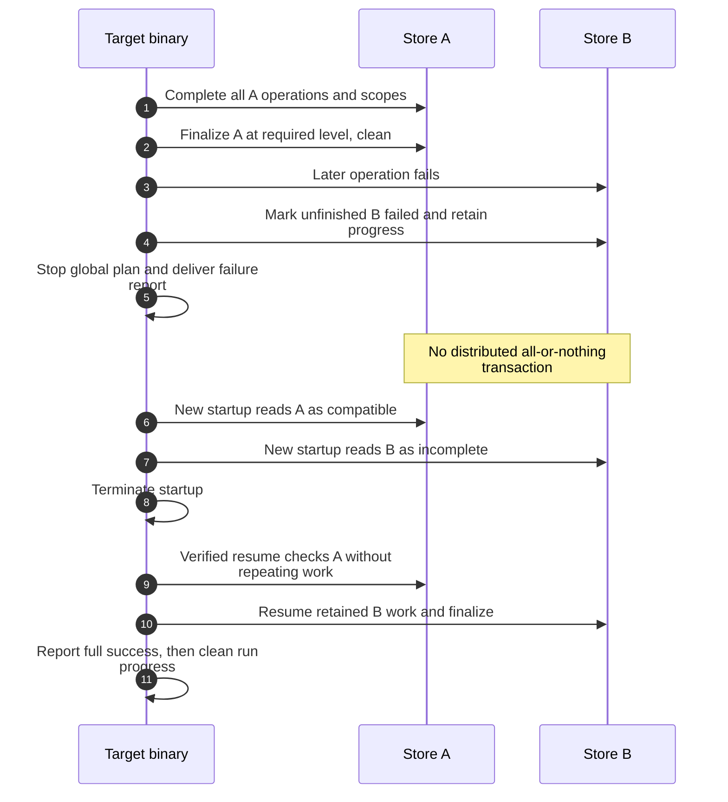

Migration, attempted startup and resume are separate invocations of the same target artifact. A's
progress remains reportable until the full run succeeds; A's clean level is not rolled back because B failed.

#### F15: Competing engines cannot both reserve the same store

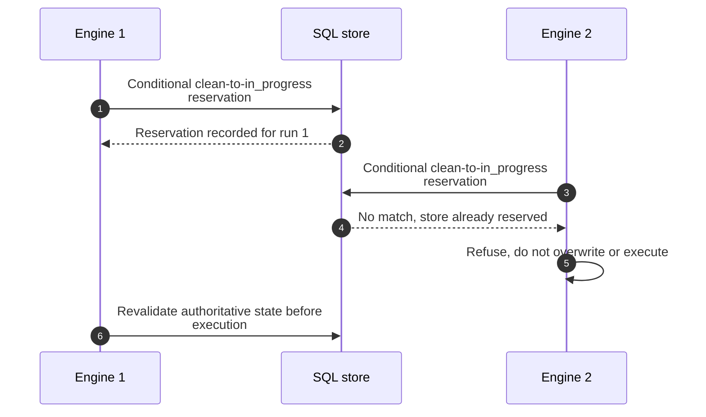

Reservations do not stop an already running serving process or external writer. Offline operation
remains the administrator's responsibility; there is no automatic stale takeover.

#### F16: Reservation fails before the first operation starts

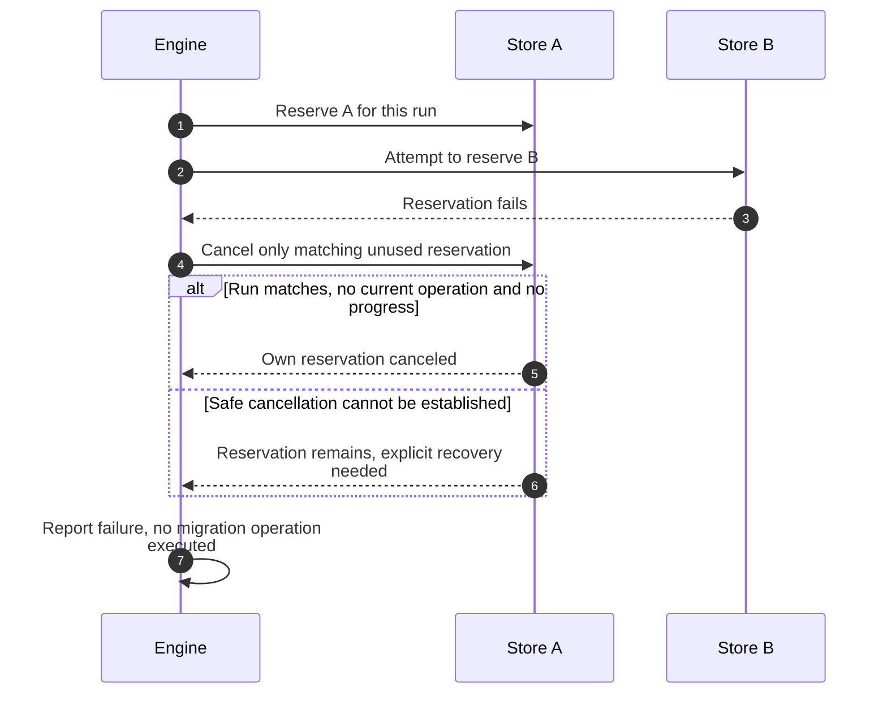

Cancellation never clears another run's reservation or erases started work.

Existing seams: [database provider](backend/internal/system/database/provider/dbprovider.go),
[query client](backend/internal/system/database/provider/dbclient.go),
[transaction handling](backend/internal/system/transaction/transactioner.go).

### 4.4 - Administrator-facing upgrade path (R2, R3, R11, R12, R16, R17, R21, R22)

The main commands are `status`, `check`, `initialize`, `apply`, `resume`, `report`,
`recover` and `abandon`. Thin shell and PowerShell wrappers invoke the same versioned binary.
Commands resolve the same home/configuration/environment as serving. No migration-specific database
or manifest override and no arbitrary store-subset option is introduced.

#### F17: Status reports recorded state and exact release guidance

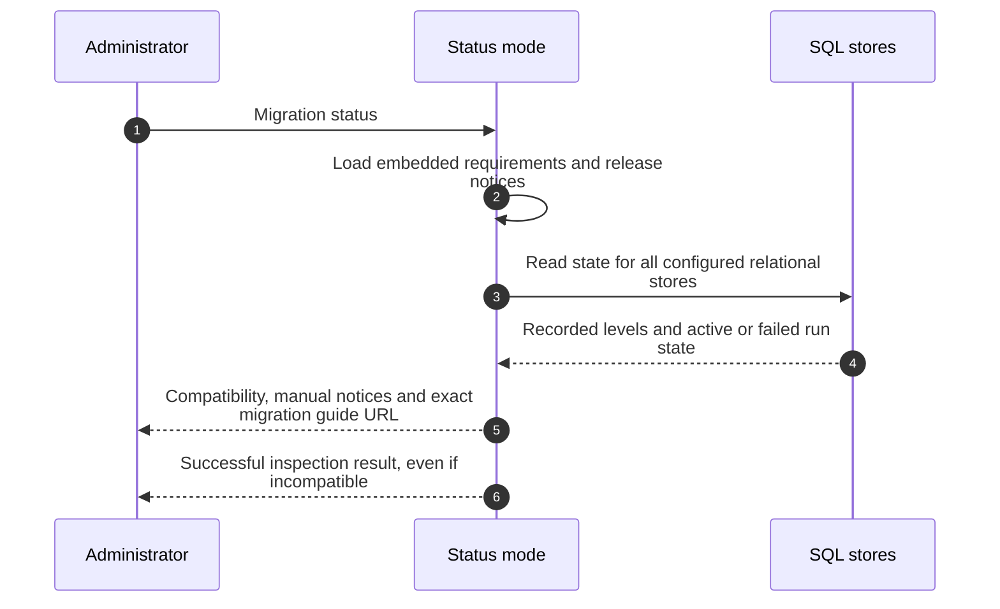

Status executes no operation readiness checks or custom file-change detectors. An unreadable store
prevents complete inspection. Guide links come from the embedded release definition, without a network request.

#### F18: Check separates database readiness from file validation and manual review

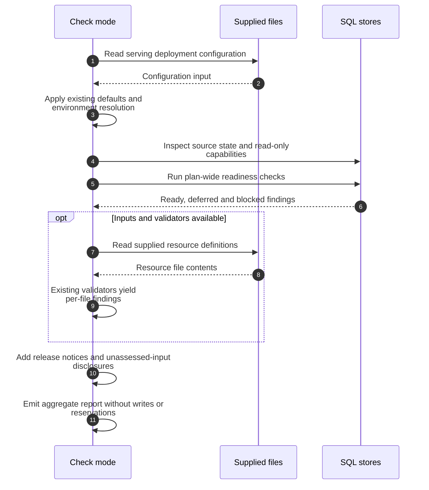

Invalid configuration can prevent store discovery. Independent discoverable findings are aggregated.
Missing resource inputs or uncovered changes are manual-review notices, not proof of compatibility
or database blockers by themselves. Check success is not a guarantee that later apply succeeds.

#### F19: Administrator updates configuration and declarative files manually

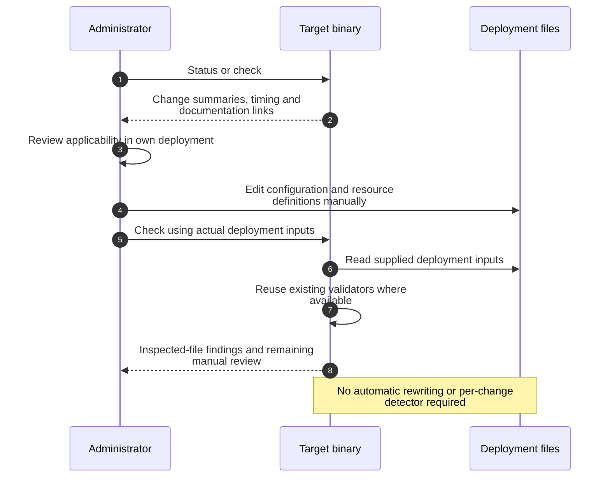

Actions occur at the guide's specified times: before migration, before startup or before resource
import. Database completion does not certify these actions. External declarative files and persisted
ThunderID-owned content are different migration concerns.

#### F20: Normal adjacent-release upgrade from the administrator's perspective

```mermaid
sequenceDiagram
    autonumber
    participant A as Administrator
    participant T as Target binary
    participant D as SQL stores
    A->>T: Status using new release artifact
    T->>D: Read recorded source levels
    T-->>A: Exact guide and database/manual change<br/>notices
    A->>A: Back up and stop every affected instance
    A->>A: Complete any before-migration manual<br/>actions
    opt Preview before execution
        A->>T: Migrate check
        T-->>A: Readiness and manual-review findings
    end
    A->>T: Migrate apply
    T->>D: Mandatory validation, reservation and<br/>ordered execution
    T->>D: Verify and finalize all required stores
    T-->>A: Deliver final report
    T->>D: Clean progress after full success and<br/>delivery
    A->>A: Complete remaining before-startup manual<br/>actions
    A->>T: Start target release
    T->>D: Read-only compatibility gate
    T->>T: Initialize runtime services and serve
```

This is the successful path. Known check blockers must be resolved. Apply repeats validation even
when check was omitted or previously passed. No offline/backup acknowledgement flags or prompts are
required. Setup and start never automatically apply an upgrade.

#### F21: A release has no database migrations

Scenario: all configured stores already match valid clean target requirements and no prior report
or cleanup work is pending. Configuration/resource changes may still require manual action.

```mermaid
sequenceDiagram
    autonumber
    participant T as Target binary
    participant D as SQL stores
    T->>D: Validate all recorded levels against<br/>unchanged requirements
    D-->>T: All compatible and clean
    T->>T: No pending operations or reservations
    T->>T: Report verified no-op and manual release<br/>notices
    Note over T,D: No schema, content or completed-level<br/>updates
    T->>D: Subsequent startup reads compatibility<br/>state
    T->>T: Serve after gate passes
```

Patch releases are not assumed migration-free. The manifest decides whether a store changes.

#### F22: Walk several published releases with each target's own artifact

**Open detail:** this is the conceptual orchestration path, not a finalized management CLI or deployment implementation.

```mermaid
sequenceDiagram
    autonumber
    participant C as Admin or coordinator
    participant T as Selected target artifact
    participant D as SQL stores
    C->>C: Resolve ordered published releases and<br/>review manual actions
    C->>C: Back up and stop affected instances
    loop Each adjacent target release in order
        C->>T: Invoke this target's migration command
        T->>D: Validate its accepted source and<br/>required levels
        T->>D: Apply declared changes or verify no-op
        T-->>C: Hop outcome and report
        break Hop failed or cannot safely advance
            C->>C: Stop walk and report completed and<br/>remaining hops
        end
    end
    C->>T: Start final target only after every hop<br/>succeeds
    T->>D: Final startup compatibility gate
```

The selected artifact changes for each hop. A no-migration release still belongs to the path.
Intermediate binaries need not serve traffic. An unfinished older plan is resumed with its owning
artifact, not reinterpreted by the latest binary. Multi-store partial failures can require that
recovery before any single release can serve again; completion is not treated as a global rollback.

### 4.5 - Failure, interruption and recovery (R10, R14, R15)

#### F23: Handled failure or graceful cancellation followed by resume

```mermaid
sequenceDiagram
    autonumber
    participant M as Engine
    participant D as SQL stores
    participant A as Administrator
    M->>D: Current atomic unit or batch fails or is<br/>canceled
    M->>D: Roll back current transaction
    M->>M: Stop global operation plan
    M->>D: Mark unfinished reservations failed<br/>where possible
    M-->>A: Failure report, current operation and<br/>next action
    Note over M,D: Committed units and all retained<br/>progress survive
    A->>A: Correct cause and keep affected<br/>instances stopped
    A->>M: Resume using same owning release<br/>artifact
    M->>D: Verify retained run, scopes, checkpoints<br/>and data
    M->>D: Reserve failed stores and continue<br/>verified work
    M-->>A: Final report after complete migration
    M->>D: Clean progress only after full success<br/>and delivery
```

Failure-state recording is best effort when connectivity fails. If it cannot complete, use the
stranded-run path rather than assuming the durable state became failed.

#### F24: Abrupt interruption requires explicit recovery before resume

```mermaid
sequenceDiagram
    autonumber
    participant A as Administrator
    participant T as Owning release binary
    participant D as SQL stores
    A->>T: Status or resume after interrupted<br/>executor
    T->>D: Read retained in_progress run
    T-->>A: Refuse takeover, identify expected run
    A->>A: Ensure previous executor actually<br/>stopped
    A->>T: Recover with exact run identity
    T->>D: Validate and conditionally update<br/>matching run
    alt Expected run and state valid
        T->>D: Mark stranded state failed, preserve<br/>progress
        T-->>A: Run may now be resumed
        A->>T: Resume with same release artifact
        T->>D: Verify and continue retained work
    else Wrong run or changed state
        T-->>A: Refuse without overwriting metadata
    end
```

No age or timeout proves the executor stopped. Stopping it is a documented administrator prerequisite,
reinforced by output reminders, not a confirmation flag or interactive prompt. Exact run selection
and conditional state checks remain mandatory.

#### F25: Restoration and abandon are not automatic rollback

```mermaid
sequenceDiagram
    autonumber
    participant A as Administrator
    participant D as SQL stores
    participant T as Recovery mode
    A->>A: Keep affected instances stopped
    A->>D: Restore or correct all affected stores<br/>under recovery guide
    A->>T: Abandon matching unfinished run with<br/>explicit authorization
    T->>D: Verify recognized complete levels and<br/>invariants
    alt All affected stores form a complete recognized state
        T->>D: Conditionally clear matching unfinished<br/>metadata
        T-->>A: Verified abandonment result
    else Partial restoration, wrong run or invalid state
        T-->>A: Refuse, do not erase retained work by<br/>assertion
    end
```

**Open detail:** restoration can restore migration metadata too; exact run correlation and verification
inputs must be finalized. A complete backup restoration may already remove the unfinished run, so
abandon is not mandatory after every restore. Returning to an older binary requires compatible data,
not just swapping executables. Initialize must not be used to reset retained failed-run records.

#### F26: Data reached target but store finalization failed

```mermaid
sequenceDiagram
    autonumber
    participant M as Engine
    participant D as SQL store
    M->>D: Exact application target already<br/>verified
    M->>D: Attempt conditional store finalization
    D-->>M: Finalization failed, state remains<br/>incomplete
    M->>M: Report failure, target startup remains<br/>blocked
    Note over M,D: Recover first if durable state remains<br/>stranded in_progress
    M->>D: Verified resume recognizes exact target<br/>data
    M->>M: Do not repeat committed transformations
    M->>D: Reverify completion and retry<br/>finalization
    D-->>M: Required completed level and clean state<br/>established
```

Reaching target data is not enough: authoritative state must also be successfully finalized.

### 4.6 - Reporting and cleanup (R3, R13, R14)

Human-readable output is the default, with optional JSON. JSON occupies standard output exclusively;
the human-readable report goes to the requested file or standard error. Sensitive values are omitted.

#### F27: Progress retention depends on migration and report outcomes

```mermaid
flowchart TD
    A[Orderly run outcome] --> B{Entire multi-store migration complete?}
    B -->|No| C[Attempt failure report delivery]
    C --> D([Retain all progress, including completed scopes])
    B -->|Yes| E[Deliver final human-readable report]
    E --> F{Report delivered?}
    F -->|No| G([Retain progress for report retry])
    F -->|Yes| H[Conditionally clean successful-run progress]
```

Report delivery never deletes failed/incomplete-run progress. Compatible clean target levels remain
valid when only reporting or housekeeping fails; those problems do not require rerunning migration.

#### F28: Report delivery fails after migration completes

```mermaid
sequenceDiagram
    autonumber
    participant M as Migration or report mode
    participant D as SQL stores
    participant F as Report destination
    M->>D: All stores finalized clean at target
    M->>F: Deliver requested human-readable report
    F-->>M: Delivery fails
    M->>M: Return report failure, tentative exit 5
    Note over M,D: Clean levels unchanged, progress<br/>retained
    M->>M: After destination correction, invoke<br/>report-only command
    M->>D: Read retained run state and progress
    M->>F: Reconstruct and redeliver report
    F-->>M: Report delivered
```

The report-only command does not execute migration or change database metadata. Housekeeping after
redelivery is read-only; explicit `report --cleanup` performs verified cleanup. The database gate may pass while
report delivery remains pending; other startup/manual prerequisites still apply.

#### F29: Cleanup fails after the final report was delivered

The tentative `report --cleanup` entry point is agreed. Saved-report correlation after partial
multi-namespace cleanup remains open.

```mermaid
sequenceDiagram
    autonumber
    participant M as Engine
    participant D as SQL stores
    participant A as Administrator
    M-->>A: Final successful report delivered
    M->>D: Conditional cleanup for completed run
    D-->>M: Some cleanup writes fail
    M-->>A: Migration complete, housekeeping<br/>incomplete, tentative exit 5
    Note over M,D: Clean target levels remain, no migration<br/>repeated
    A->>M: Run report --cleanup with saved report<br/>correlation rules pending
    M->>D: Guarded idempotent cleanup of remaining<br/>matching metadata
```

Do not treat exit 5 as permission to repeat already completed transformations.

#### F30: JSON result output does not replace the human-readable report

```mermaid
flowchart TD
    A[JSON-mode migration outcome] --> B{Report file requested?}
    B -->|Yes| C[Deliver human-readable report to file]
    B -->|No| D[Deliver human-readable report to stderr]
    C --> E[Apply migration and report cleanup policy]
    D --> E
    E --> F[Emit JSON result only on stdout]
    F --> G[Exit with command outcome code]
```

Report failure retains progress. Diagnostic logs also use stderr, so stderr is not a structured
machine-readable stream. Report paths and result details must not expose sensitive identity values.

Tentative exit codes: `0` command success, `1` operational error, `2` invalid arguments/configuration,
`3` validation blocked, `4` migration failed/incomplete, `5` migration complete but reporting/cleanup
failed. Successful status inspection can return `0` while reporting incompatible databases.

### 4.7 - Repository and implementation outline (R7, R18, R20, R23)

Proposed source layout, not yet implemented:

```text
backend/internal/system/migration/
  contract/           shared operation and verification types
  engine/             orchestration, progress and recovery
  releases/v1_1_0/    canonical manifest and immutable ordered operations
  current/            explicit binding to exactly one release package
```

The current binding imports one target release package, embedding its manifest and compiling its
operations. Historical packages remain in source for traceability; they are not all bundled into the
latest binary. Runtime does not read executable migration SQL from external files.

The key startup change is early dispatch in [main.go](backend/cmd/server/main.go). Today it initializes
cache and the full service graph before detecting bootstrap. Migration must instead load minimal
configuration/logging, dispatch its isolated mode and initialize only its required dependencies.
Serving and bootstrap must pass the gate before initializing schema-dependent services.

Reuse existing provider/query/transaction facilities after verifying they meet the engine's atomicity
and capability contracts. Logical-store keyed transactions and shared physical namespaces need
explicit review; their current behavior is not proof of distributed or cross-store atomicity.
No new migration framework dependency is selected. Build and CI wiring changes remain proposed work,
not changes made by this document.

#### F31: Developer changes become a validated release artifact

```mermaid
flowchart TD
    A[Change current schema or persisted content] --> B[Update fresh-provider scripts and targeted migration operations]
    B --> C[Define readiness, pre/post verification and interruption mode]
    C --> D[Register explicit release-wide operation order]
    D --> E[Add manifest levels and manual-action release notices]
    E --> F[Test both providers, target equivalence and interruption cases]
    F --> G[Bind current package to this release only]
    G --> H[Build and validate embedded definition and readable copy]
    H --> I([Package release with wrappers and published guide])
```

This is proposed release integration, not a changed CI pipeline. Version-specific operation packages
remain in source for traceability. The next release selects its own package rather than dynamically
loading historical operations or administrator-supplied SQL. Targeted built-in-resource operations
must not wholesale reapply customized bootstrap bundles.

### 4.8 - Illustrative operation code and engine connections (R10, R20, R23, R24)

These are simplified Go-style demonstration snippets, not compilable code or finalized APIs.
Callback signatures, context/access plumbing and error handling are abbreviated to make the lifecycle
easy to follow. Named helpers represent real checks, not unconditional success stubs. Production
implementations must propagate errors and follow the contracts in the detailed design.

The fictional `EXAMPLE_RECORD` table belongs to the `entity` store and initially contains UUID `ID`,
`LABEL` and `DEPLOYMENT_ID` columns. The example adds nullable `NORMALIZED_LABEL TEXT`, then populates
it from the label using a small Go transformation. This is not a proposed normalization policy for
usernames, credentials or other real ThunderID identity fields.

| Operation | Category | Scope | Interruption mode | Exact target |
|---|---|---|---|---|
| `1.1.0.entity.add_normalized_label` | SQL | Store | Atomic | Column exists with the required type, nullability and default |
| `1.1.0.entity.populate_normalized_label` | Programmatic | Store | Atomic | Every row's normalized label equals the defined transformation |

The plan explicitly registers column-add before population. The transformation is deliberately small
to illustrate hooks, not to claim that it inherently requires Go. A large-table production operation
would need a separately chosen and tested batching strategy, such as F11's resumable contract.

#### F34: Release operations are adapted to one engine contract

```mermaid
flowchart TD
    A[Release plan registers ordered operations] --> B[Constructors validate required hooks and metadata]
    B --> C[SQLOperation adapter]
    B --> D[ProgrammaticOperation adapter]
    C --> E[Common Operation contract]
    D --> E
    E --> F[Engine invokes lifecycle in global order]
```

The engine uses the common interface. Concrete adapters implement SQL-statement dispatch or invoke
the registered programmatic executor; they do not take ownership of store finalization or reporting.

#### F35: The engine supplies capabilities and owns metadata

```mermaid
flowchart TD
    A[Engine orchestrator] --> B[Read-only hooks]
    B --> C[ReadAccess:<br/>declared stores only]
    A --> D[Execution phase]
    D --> E[Atomic: ExecutionAccess<br/>one store transaction]
    D --> F[Resumable: engine-driven batches<br/>data plus checkpoint]
    A --> G[Private lifecycle]
    G --> H[Reservations and progress<br/>levels, reports, cleanup]
```

This diagram shows responsibilities, not new independently deployed components. Readiness receives
immutable `PlanContext`, not execution access. Resumable executors receive a checkpoint and committer,
not unrestricted writable access. Operation code cannot mutate migration tables, advance a level,
construct arbitrary global providers or independently commit an engine-owned transaction.

#### SQL sample: add a column

The developer supplies SQL and three checks. The SQL adapter supplies `Execute`; developers do not
write another SQL execution callback.

```go
column := SQLOperation{
    DefinitionValue: OperationDefinition{
        ID: columnOperationID, // "1.1.0.entity.add_normalized_label"
        StoreID: "entity", ScopeType: "store", InterruptionMode: "atomic",
    },
    ReadinessChecker: checkColumnReadiness,
    ScopeResolver:   entityStoreScope,
    PreVerifier:     verifyColumnState,
    Implementations: map[DatabaseType]SQLImplementation{
        "postgres": {Statements: []SQLStatement{{
            ID: "MIG-ENTITY_MGT-01",
            Query: `ALTER TABLE "EXAMPLE_RECORD" ADD COLUMN "NORMALIZED_LABEL" TEXT`,
        }}},
        "sqlite": {Statements: []SQLStatement{{
            ID: "MIG-ENTITY_MGT-01",
            Query: `ALTER TABLE "EXAMPLE_RECORD" ADD COLUMN "NORMALIZED_LABEL" TEXT`,
        }}},
    },
    PostVerifier: requireExactColumn,
}

// Simplified helper bodies; engine-supplied read access is omitted.
func checkColumnReadiness() ReadinessResult {
    return checkExpectedBaseTableAndAnyExistingColumn()
}

func verifyColumnState() VerificationResult {
    // Absent = source; exact definition = target; conflicting definition = invalid.
    return classifyColumn("EXAMPLE_RECORD", "NORMALIZED_LABEL", "nullable TEXT, no default")
}

func requireExactColumn() VerificationResult {
    return requireTarget(verifyColumnState())
}
```

| Hook | What happens |
|---|---|
| Readiness | Check the expected base table. A conflicting existing column blocks migration. |
| Pre-verify | Classify the column as absent, exactly correct or invalid. |
| Execute | Adapter selects the provider's statements and executes them in order if source is verified. |
| Post-verify | Require the exact target column, including type, nullability and default. |

Existence alone is not sufficient. An exact target skips SQL execution, but still passes post-verification.
Provider inspection and query execution errors stop the migration.

#### F36: SQL operation hooks and engine execution

```mermaid
sequenceDiagram
    autonumber
    participant M as Engine
    participant O as SQL operation adapter
    participant D as Owner SQL store
    M->>O: CheckReadiness with read access and plan
    O->>D: Inspect source schema without writes
    O-->>M: Ready or blocked
    Note over M,D: After successful reservation and revalidation
    M->>D: Begin engine-owned atomic transaction
    M->>O: PreVerify scope using transaction read access
    O->>D: Classify absent, exact or invalid column
    O-->>M: Source, target or invalid
    opt Source verified
        M->>O: Execute with transaction-bound write access
        O->>D: Selected provider statements in slice order
    end
    M->>O: PostVerify exact target column
    O->>D: Inspect schema in the same transaction
    O-->>M: Target or failure
    M->>D: Commit data and completed progress together
```

This is the successful path after ready/source or exact-target classification. Invalid state or any
execution/verification/progress failure rolls back the scope transaction. Store level advancement is
a later engine finalization check, not the operation's return value.

#### Programmatic sample: populate the new column

The plan registers column-add first, then this operation. A small transformation demonstrates compiled
Go logic; it is not a proposed policy for real identity fields.

```go
population := ProgrammaticOperation{
    DefinitionValue: OperationDefinition{
        ID: "1.1.0.entity.populate_normalized_label",
        StoreID: "entity", ScopeType: "store", InterruptionMode: "atomic",
    },
    ReadinessChecker: checkPopulationReadiness,
    ScopeResolver:   entityStoreScope,
    PreVerifier:     verifyPopulationState,
    Executor:        populateLabels,
    PostVerifier:    requireExactPopulation,
}

// Simplified callbacks; context, access and error returns are omitted.
func checkPopulationReadiness(plan PlanContext) ReadinessResult {
    checkSourceLabels() // Reads LABEL only; never reads a missing target column.
    return checkColumnOrDeferToPrecedingOperation(plan, columnOperationID)
}

func verifyPopulationState() VerificationResult {
    // First require the exact column, then inspect all rows.
    // All NULL = source; all correctly normalized = target; mixed/wrong = invalid.
    return classifyNormalizedLabels()
}

var updateLabel = dbmodel.DBQuery{
    ID: "MIG-ENTITY_MGT-02",
    PostgresQuery: `UPDATE "EXAMPLE_RECORD" SET "NORMALIZED_LABEL" = $1
        WHERE "ID" = $2 AND "DEPLOYMENT_ID" = $3`,
    SQLiteQuery: `UPDATE "EXAMPLE_RECORD" SET "NORMALIZED_LABEL" = $1
        WHERE "ID" = $2 AND "DEPLOYMENT_ID" = $3`,
}

func populateLabels() {
    for _, row := range readAllExampleRows() {
        normalized := strings.ToLower(strings.TrimSpace(row.Label))
        executeBoundQuery(
            updateLabel, normalized, row.ID, row.DeploymentID,
        ) // Require exactly one affected row; any error stops execution.
    }
}

func requireExactPopulation() VerificationResult {
    return requireTarget(verifyPopulationState())
}
```

| Hook | What happens |
|---|---|
| Readiness | Validate source labels. If column-add must run first, explicitly defer that check; a conflicting column blocks migration. |
| Pre-verify | Require the exact column, then classify content as source, target or invalid. |
| Execute | Transform each label and update it using bound values and the deployment identifier. |
| Post-verify | Require every stored value to equal the expected transformation. |

The source-label check rejects labels that normalize to empty. Readiness deferral is allowed only when
the required column-add is an earlier operation in the plan. An empty table is already at target once
the schema is verified. This atomic example treats mixed content as invalid, not a checkpoint.

The scope helper returns one store scope, `entity`. All rows across affected deployments are checked;
each update remains deployment-qualified. Read/write helpers use the declared owner store and
engine-owned transaction. Operation code never commits, advances levels or writes migration metadata.
Larger datasets would use a separately designed resumable executor.

`executeBoundQuery` represents engine-provided execution access. Its database adapter selects
`PostgresQuery` or `SQLiteQuery` for the owner store. The SQL is identical here, but the variants may
differ when provider syntax requires it; programmatic operations are not restricted to generic SQL.

#### F37: Programmatic hooks and transaction-bound execution

```mermaid
sequenceDiagram
    autonumber
    participant M as Engine
    participant O as Programmatic operation
    participant D as Owner SQL store
    M->>O: CheckReadiness with read access and plan
    O->>D: Validate existing labels without new-column reads
    O-->>M: Deferred if preceding column-add is still required
    Note over M,D: Column-add completes first in global order
    M->>D: Begin atomic population transaction
    M->>O: PreVerify exact source or target content
    O->>D: Read schema and all labels in same transaction
    O-->>M: Source, target or invalid
    opt Source verified
        M->>O: Invoke atomic executor with owner write access
        O->>O: Apply Go transformation to each label
        O->>D: Parameterized updates with deployment IDs
    end
    M->>O: PostVerify exact target content
    O->>D: Read and compare every target value
    O-->>M: Target or failure
    M->>D: Commit data and completed progress together
```

This is the successful execution path. Blocked readiness or invalid pre-verification does not reach
the executor. A target result skips writes, not exact post-verification. Any atomic failure rolls back.
The engine advances the store only after every owned operation and scope succeeds.

#### Resumable sample: engine-driven batches and checkpoints

This is a simplified alternative to the atomic population sample, not another operation to run after
it. The proposed `BatchExecution` callbacks refine the earlier operation-owned `BatchCommitter`
contract. Names, signatures and error plumbing are illustrative, not finalized or compilable APIs.

```go
populationInBatches := ProgrammaticOperation{
    DefinitionValue: OperationDefinition{
        ID: "1.1.0.entity.populate_normalized_label",
        StoreID: "entity", ScopeType: "deployment", InterruptionMode: "resumable",
    },
    ReadinessChecker: checkPopulationReadiness,
    ScopeResolver:   discoverAffectedDeployments,
    PreVerifier:     verifyDeploymentAndCheckpoint,
    BatchExecution: BatchExecution{
        SelectNext:         selectLabelBatch,
        ExecuteBatch:       normalizeLabelBatch,
        ValidateCheckpoint: validateLabelCursor,
    },
    PostVerifier: requireEveryLabelNormalized,
}

// Read-only: engine supplies scope, validated cursor and batch limit.
// Simplified helpers return errors to the engine; nil cursor means start.
func selectLabelBatch(read ReadAccess, scope Scope, cursor LabelCursor, limit int) Batch {
    rows := readLabelsAfterID(read, scope.ID, cursor.AfterID, limit)
    if len(rows) == 0 {
        return Batch{Done: true}
    }
    return Batch{
        Rows: rows,
        NextCheckpoint: versionedCursor(1, rows[len(rows)-1].ID),
    }
}

// Engine supplies write access inside its batch transaction.
// updateLabel has explicit PostgreSQL/SQLite variants in the prior sample.
func normalizeLabelBatch(write ExecutionAccess, scope Scope, batch Batch) error {
    for _, row := range batch.Rows {
        value := strings.ToLower(strings.TrimSpace(row.Label))
        if err := updateOneLabel(write, updateLabel,
            value, row.ID, scope.ID); err != nil {
            return err
        }
    }
    return nil
}
```

The operation's helpers define data-specific behavior: stable deployment-filtered selection,
normalization and exact verification. Cursor validation rejects unknown versions or malformed data;
pre-verification checks that the processed prefix and remaining data match the retained cursor.
Updates reject empty normalized labels and require one affected row.

The engine, not the operation, owns the repeating lifecycle:

```text
Load retained checkpoint and validate through the operation
Pre-verify the scope's observed state against that checkpoint
For each batch:
    Begin owner-store transaction
    Call SelectNext with transaction-bound read access
    If Done: finish selection without advancing the checkpoint
    Otherwise call ExecuteBatch with transaction-bound write access
    Persist NextCheckpoint in the same transaction
    Commit data + checkpoint together; advance only after commit
Post-verify the entire scope, then record scope completion
```

Any selection, execution or checkpoint failure stops the loop and rolls back the current transaction.
Earlier committed batches remain available for verified resume. `Done` is not completion evidence:
exact post-verification must pass. Already-target scopes skip execution, but still post-verify.

Selection uses immutable, uniquely ordered IDs and keyset pagination, not mutable offsets.
Batch bounds and checkpoint advancement are validated by the engine. This assumes external writers
remain stopped and all affected deployment scopes are discovered. No operation receives permission
to write migration metadata, commit transactions or orchestrate its own resume loop.

## 5 - Decisions

| Decision | Why | Alternative not selected |
|---|---|---|
| One executable, isolated modes | Manifest and operations match the target artifact | Separate migration executable with another packaging/version relationship |
| Embedded manifest plus readable copy | Runtime requirements cannot drift with an edited file | External manifest as runtime authority |
| Adjacent published-release transitions | Explicit, reviewable upgrade path and bounded testing | One binary interpreting every historical baseline |
| Independent store levels | Supports multi-store changes and unchanged stores | One product-version label for all databases |
| Read-only terminating startup gate | Incompatible data never reaches normal runtime services | Automatic startup migration or partial serving |
| Verified resume, not universal rollback | Cross-store and destructive changes cannot be reversed universally | Promising all-or-nothing distributed rollback |
| One trust-based initialize command | Simple registration based on metadata presence; preserve existing rows | Separate adopt-baseline command and exhaustive baseline validators |
| Notices and existing validators | Avoids a parallel per-change validation system | Mandatory custom config/resource detectors |

## 6 - Failure modes

| Condition | Behavior |
|---|---|
| Missing, incorrect or unreadable store state | Startup fails closed before serving |
| Readiness blocker or invalid source state | Refuse the action; do not advance a level |
| Operation failure | Stop global plan; retain verified durable work and resumable progress |
| Abrupt termination | Refuse automatic takeover; require explicit recovery |
| Some stores complete, others fail | Target startup remains blocked; resume unfinished work |
| Migration completes but reporting fails | Keep clean target levels and progress; return unsuccessful command result |
| Cleanup fails after report delivery | Report housekeeping failure; do not repeat operations |
| Manual changes are unassessed | Disclose review limits; do not claim full deployment readiness |

Recovery is forward resume or verified restoration, not guaranteed reversal. External writers remain
an accepted operational risk because reservations cannot quiesce them.

## 7 - Data model

This overview summarizes the agreed logical model. Full columns and constraints are maintained in
Decision 2 of [the detailed log](migration-design-decisions.md); provider-specific DDL is implementation work.

| Table | Meaning | Lifetime |
|---|---|---|
| `MIGRATION_STATE` | One row per store: metadata format, completed level, status, active target/run and bounded last failure | Persistent compatibility evidence |
| `MIGRATION_PROGRESS` | Operation/scope status and versioned checkpoint for an unfinished or not-yet-reported run | Retained until complete success, final report delivery and cleanup |

One SQLite file or PostgreSQL database/schema namespace has one pair of tables. Shared stores have
separate `STORE_ID` rows in that pair. Separate namespaces have separate pairs. No dedicated migration
database is introduced. Failure code and summary live only in state, not both tables.

Migration metadata is store-owned, not deployment-owned. It deliberately omits the usual application
`DEPLOYMENT_ID`; deployment identity appears in progress scope when needed. This is an explicit
system-metadata exception to normal application-table conventions, not a change to isolation rules.
A store reaches its target only after all affected deployments' required work completes.

### 7.1 - F32: Logical stores share one physical SQL namespace

```mermaid
sequenceDiagram
    autonumber
    participant T as Target binary
    participant D as Shared SQL namespace
    T->>D: Read MIGRATION_STATE row for config
    D-->>T: Independent config completed level and<br/>status
    T->>D: Read MIGRATION_STATE row for entity
    D-->>T: Independent entity completed level and<br/>status
    T->>D: Ordered operation updates only its<br/>writable store
    T->>D: Progress keyed by run, store, operation<br/>and scope
    Note over T,D: One metadata table pair, separate<br/>logical store rows
```

One physical database does not imply one migration level or automatic cross-store atomicity.

### 7.2 - F33: Logical stores use separate physical SQL namespaces

```mermaid
sequenceDiagram
    autonumber
    participant T as Target binary
    participant X as Namespace A
    participant Y as Namespace B
    T->>X: Read A's metadata and store level
    T->>Y: Read B's metadata and store level
    T->>X: Reserve and update A using correlated<br/>run ID
    T->>Y: Reserve and update B using same run ID
    Note over X,Y: Separate metadata pairs, no distributed<br/>transaction
    T->>X: Independently finalize A after all its<br/>scopes complete
    T->>Y: Independently finalize B after all its<br/>scopes complete
    T->>T: Full success requires every configured<br/>store compatible
```

The shown updates follow global plan order, not parallel or unverified execution. Hybrid layouts
combine F32 and F33: some stores share a pair while others own separate pairs.

## 8 - Threat model

The migration caller is a trusted deployment administrator with schema/data-changing credentials.
There is no remotely exposed migration API. Serving should not require schema-altering permissions
solely to run the gate. Migration authority comes from the executable, while database state is trusted
evidence established by verified actions; it is not tamper-proof against a privileged database owner.

Typed SQL uses bound values for data and scope inputs. Output excludes credentials, sensitive
connection details and copied identity records. Selected domain/cryptographic operations obey existing
provider boundaries. Store reservations control competing migration engines, not every possible
writer. Wrong-run protection and conditional state changes remain necessary despite that trust.

## 9 - Requirements traceability

Coverage below is at overview/design-intent level, not a statement that implementation or verification
is complete. The local requirements include refinements not yet published to GitHub.

| Requirement | Coverage | Sections |
|---|---|---|
| R1 Continuity | Covered in approach | 4.3, 4.5 |
| R2 Offline upgrade | Covered in approach | 4.4, 8 |
| R3 Unattended operation | Partly covered; JSON contract pending | 4.4, 4.6 |
| R4 Separate migration/serving | Covered in approach | 3, 4.1, 4.7 |
| R5 Recorded levels | Covered in approach | 4.1, 7 |
| R6 Startup check | Covered in approach | 4.1 |
| R7 Fresh/upgrade equivalence | Partly covered; test wiring pending | 4.2, 4.7, 11 |
| R8 Declared paths | Covered in approach | 4.1, 4.4 |
| R9 Built-in resources | Covered in approach; operations authored per release | 4.2, 4.3 |
| R10 Operation integrity | Partly covered; concrete adapters pending | 4.3, 4.5, 4.7, 4.8 |
| R11 Migration notes | Covered in approach | 4.4 |
| R12 Preflight | Covered in approach | 4.3, 4.4 |
| R13 Reports | Partly covered; schema/retry details pending | 4.6 |
| R14 Recovery | Partly covered; exceptional CLI details pending | 4.5, 4.6 |
| R15 Safe refusal | Covered in approach | 4.1, 4.3, 6 |
| R16 Configuration changes | Partly covered; notice representation pending | 4.4 |
| R17 Declarative resources | Partly covered; validator coverage pending | 4.4 |
| R18 Release verification | Partly covered; concrete matrix/wiring pending | 4.7, 11 |
| R19 Every release declares impact | Covered in approach | 4.1 |
| R20 Developer declarations | Covered in approach | 4.3, 4.7, 4.8 |
| R21 Upgrade procedures | Partly covered; deployment-specific guides pending | 4.4 |
| R22 Multiple adjacent hops | Partly covered; orchestration pending | 4.4 |
| R23 Verified operations | Covered in approach | 4.3, 4.8 |
| R24 Shared deployment data | Covered in approach | 4.3, 4.8, 7 |
| R25 Initial level establishment | Policy agreed; initialization wiring and tests pending | 4.2 |

R9 migrations use targeted persisted-content operations. Upgrades do not wholesale reapply bootstrap
bundles, which could reset customized built-in resources. Transient data recreation or loss requires
explicit per-release disclosure and must not discard long-lived content.

## 10 - Open design questions

1. What are the final engine-driven batch callback and access contracts?
2. How is a saved complete report correlated for retry after partial successful-run cleanup?
3. What exact verification, authorization and partial-cleanup safeguards govern abandon?
4. How is the adjacent artifact path from fixed baseline `1.0.0` published for tools and people?
5. What are the final JSON/notice schemas, argument syntax and error precedence?
6. What orchestration does ThunderID provide for containers, Kubernetes/OpenChoreo and management CLI?

The detailed log contains the full remaining-work checklist. These questions do not reopen the
fundamentals; they must be resolved before calling the design implementation-ready.

## 11 - Proposed implementation phasing

These are planning increments, not delivery commitments or an approved milestone plan.

1. **Release contracts and state foundation.** Add manifest/plan validation, provider metadata adapters,
   trust-based initialize behavior and its tests. This establishes registered compatibility metadata.
2. **Execution and recovery engine.** Implement ordered execution, reservations, exact verification,
   atomic units, checkpointed batches, multi-deployment scopes, reporting and safe retry/recovery.
3. **Lifecycle and command integration.** Wire early routing, wrappers and fresh setup; enable the
   startup gate only when supported fresh and legacy initialization paths are available. Otherwise
   introducing the gate would strand existing installations.
4. **Release/deployment readiness.** Wire packaging checks, adjacent-transition tests and guides for
   distribution/container/Kubernetes/CLI usage. Publish release-specific manual-action notices.

Verification must cover both providers, shared/separate/hybrid SQL layouts, no-op and patch upgrades,
trust-based initialization routes, wrong sources, concurrent engines, handled failures, abrupt interruptions, scope
completion, report failures and cleanup retries. Fresh and upgraded target schemas must match; content
postconditions need their own tests. Redis follows as a separate later phase.

## 12 - Change log

| Version | Change |
|---|---|
| 0.1 | Initial meeting overview from the working requirements and design decisions, with scenario diagrams and unresolved implementation details. |
| 0.2 | Diagram-led revision with a meeting reading route and focused sequence/flow diagrams for initialization, execution, administrator actions, recovery, reporting and physical layouts. |
| 0.3 | Add illustrative SQL and atomic programmatic operations with all hooks, SQL execution dispatch, verification-helper obligations and operation-to-engine capability diagrams. |
| 0.4 | Simplify operation examples into demonstration snippets and short hook explanations, retaining the engine connection diagrams and safety boundaries. |
| 0.5 | Consolidate trust-based initialization, engine-driven batches, recovery and report-cleanup decisions; narrow the remaining-design list. |

Initialization revision: trust-based stamping supersedes earlier baseline-proof descriptions.
Exact operation verification remains required; startup trusts clean records, including initialized
levels. Correct script usage and the fixed pre-framework baseline are administrator assumptions.
