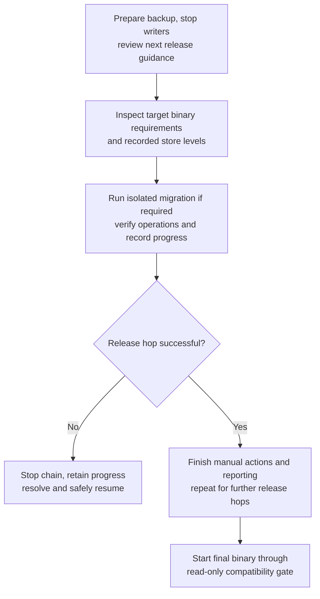
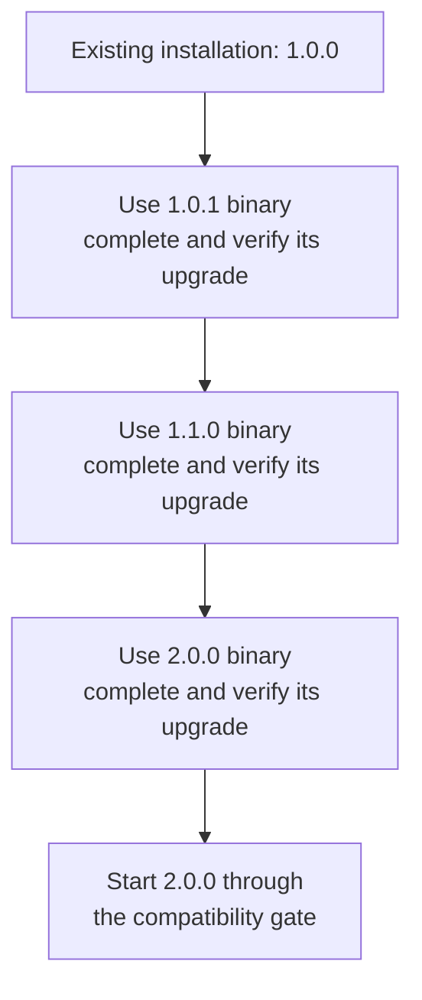
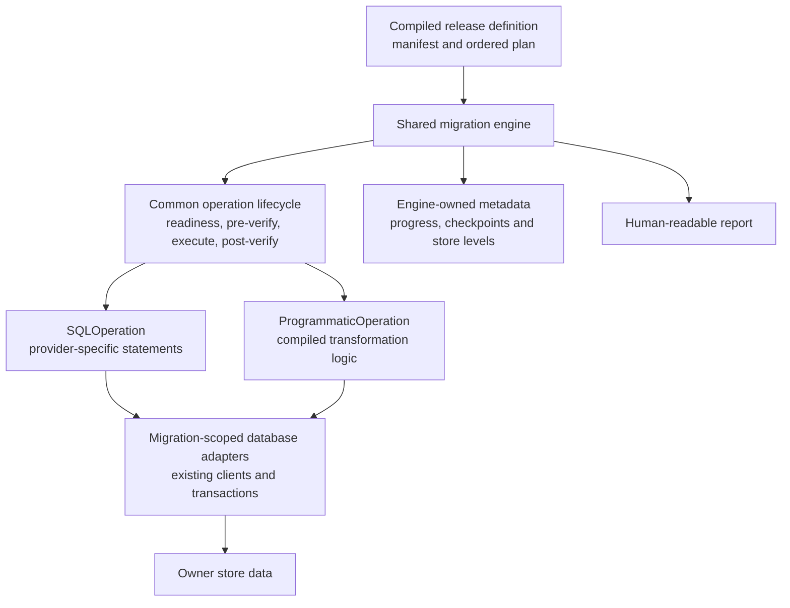
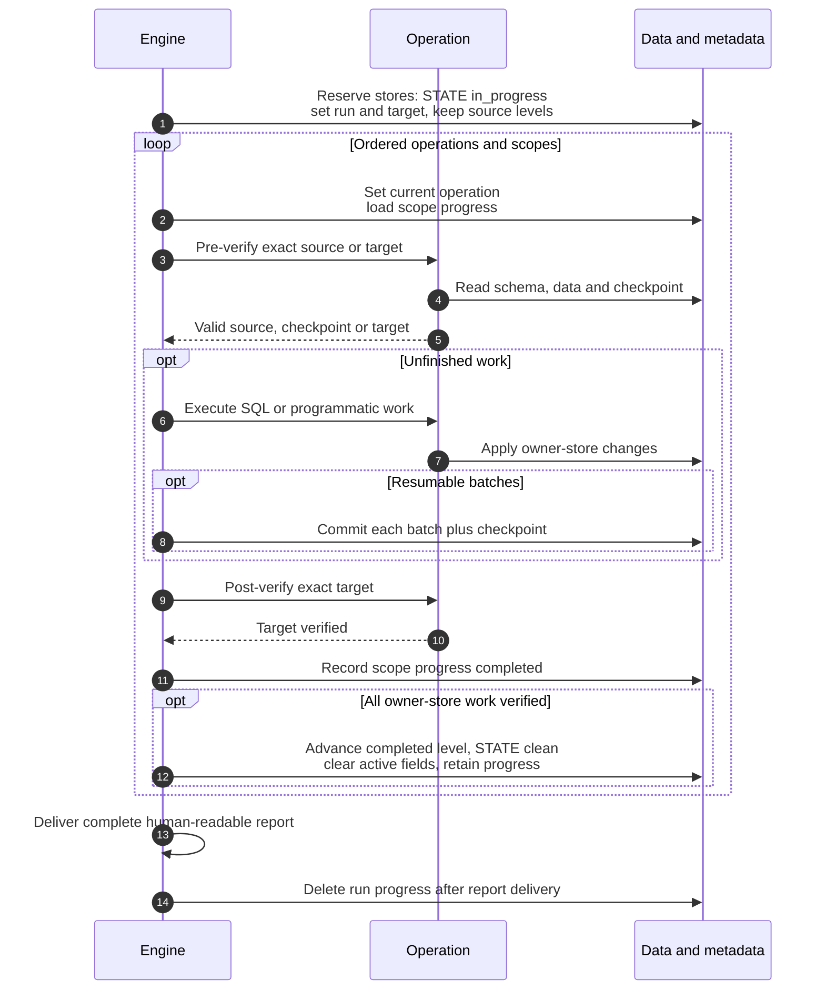
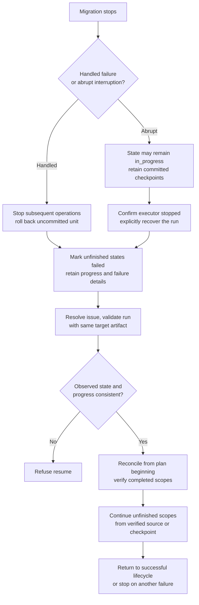

Initial leads-discussion draft, parked for further fundamental research. This describes the proposed approach, not an implemented feature.
Detailed contracts and schemas remain in [migration-design-decisions.md](migration-design-decisions.md).

## 1. Problem

- A new ThunderID release may require schema or persisted-data changes, including patch releases.
- Replacing the binary does not bring existing databases to the required migration level.
- Changes may span multiple logical stores, physical databases and deployments sharing data.
- Manual database changes can miss steps or leave an installation partially upgraded.
- Failed or interrupted migrations need a safe way to identify completed work and resume.
- ThunderID must not start against incompatible, incomplete or unverifiable database state.

## 2. Proposed solution

- Introduce an automated migration engine within the ThunderID executable, isolated from normal startup.
- Embed a release manifest defining the migration level required for each relational store. Ship a readable copy for reference.
- Record completed levels independently per store, with progress retained for unfinished migrations.
- Execute developer-defined SQL and programmatic operations in order, with readiness checks, pre-verification and post-verification.
- Upgrade one adjacent published release at a time. Support SQLite and PostgreSQL initially.
- Check compatibility during every startup. Terminate if any configured relational store fails the check; startup never runs migrations.
- Provide migration reports and release-specific guidance. Administrators remain responsible for configuration and declarative-file updates.

The read-only gate runs before normal services or bootstrap initialize. It checks recorded migration
metadata, not every schema object and data record on each startup. Migration verification establishes
that evidence. Missing, incompatible, unfinished or unreadable state terminates startup.



This is the existing-installation upgrade path. Manual configuration and declarative-file changes
follow each release's prescribed ordering, including any prerequisites before migration. Report or
cleanup failure pauses the chain for housekeeping retry, not re-execution of completed operations.
Startup never executes migration. Fresh initialization is described under the command reference.

## 3. How changes enter the upgrade path

| Change | How it is handled | Example |
|---|---|---|
| Database schema and persisted data | Developers provide SQL or programmatic operations. The migration engine verifies, executes and records completion. | Add a column, transform stored data or update persisted built-in content. |
| Deployment configuration | Release guidance explains required changes. The administrator reviews and updates the configuration; the engine does not rewrite it. | Rename a setting or supply a new required value. |
| Declarative resource files | Release guidance explains format or content changes. The administrator reviews and updates their files; the engine does not rewrite or automatically reimport them. | Update an application or flow definition managed as a file. |

- Resource handling depends on where it is managed: persisted database content uses targeted migration operations, while administrator-managed declarative files require manual updates. Upgrades do not wholesale reapply bootstrap resources.
- Database migration completion does not certify that manual file changes are complete. The administrator follows the release-specific ordering and finishes all required actions before restarting.

## 4. Upgrading across multiple releases

- Migration proceeds between **adjacent published releases**, not directly from any old version to the latest binary.
- Each hop uses its target release's binary, embedded requirements and migration operations. Complete and verify that hop before proceeding to the next.
- Patch, minor and major releases follow the same rule. Adjacent means consecutive published versions, not consecutive numeric values.
- A release with no database changes still participates in the upgrade path, but requires no database transformation. Store levels remain unchanged.
- Follow each release's guidance for manual configuration and declarative-file changes as well as database changes.

Example, assuming these are consecutive published releases:



The `2.0.0` binary owns only the `1.1.0` to `2.0.0` transition in this example; it does not contain
the whole historical chain. Serving does not need to restart between every hop, but each hop must
finish successfully before the next begins.

If a hop fails, stop the chain and recover or resume using that hop's target artifact. Some stores
may already be at its target level, so do not assume the installation rolled back to the previous
release or start an older binary without verification. Multi-hop orchestration details remain to be finalized.

## 5. Release requirements: the release manifest

- Each release has a `release-manifest.json` describing its required database migration levels and the immediately preceding release it accepts for upgrades.
- The manifest is embedded into the binary. Startup and migration commands use this embedded version only.
- The same file is shipped in the distribution for people to read. Editing it does not change the binary's requirements.
- Store levels cover both schema and persisted-data changes. An unchanged store keeps its previous level.
- SQL, operation code and execution order belong to the compiled migration plan, not the manifest.

### Sample excerpt: changed and unchanged stores

Illustrative patch release and documentation URL. The full manifest must list every supported store:

```json
{
  "manifestVersion": 1,
  "releaseVersion": "1.2.1",
  "acceptedSourceVersion": "1.2.0",
  "migrationMetadataVersion": 1,
  "migrationDocumentation": "https://thunderid.dev/docs/migrations/1.2.0-to-1.2.1",
  "stores": [
    {
      "id": "config",
      "acceptedSourceLevel": "1.1.0",
      "requiredLevel": "1.1.0",
      "changed": false
    },
    {
      "id": "entity",
      "acceptedSourceLevel": "1.2.0",
      "requiredLevel": "1.2.1",
      "changed": true
    }
  ]
}
```

The entity store advances to `1.2.1`; config stays at `1.1.0`. A store level covers both schema and
persisted-data changes, not simply the binary version. Multiple stores may change in one release.

Accepted source levels authorize the upgrade; required levels authorize serving.
The two format-version fields identify the manifest and metadata formats, not migration levels.

## 6. Database-side migration metadata

| Table | Key information | Purpose |
|---|---|---|
| `MIGRATION_STATE` | Store ID, completed level, status, target/run and last failure | Persistent compatibility evidence; startup accepts only clean state at the exact required level. |
| `MIGRATION_PROGRESS` | Run, operation, scope, status and optional checkpoint | Track unfinished work and support verified resume and reporting. |

One SQLite file or PostgreSQL database/schema namespace contains one table pair. Logical stores
sharing it have independent state rows; separate namespaces have separate pairs. No separate
migration database is introduced.

Metadata is store-owned, not deployment-owned. Deployment-specific work is tracked through scopes,
not a `DEPLOYMENT_ID` metadata column. Full columns, constraints and provider mappings:
[Decision 2](migration-design-decisions.md#decision-2-database-side-migration-state).

## 7. Migration engine implementation

Proposed implementation in Go, reusing ThunderID's database clients and transaction handling.
No mandatory third-party migration framework is introduced.

- **Release definition:** the embedded manifest and explicitly ordered operation plan are compiled into the binary. The engine does not discover SQL files or infer order from filenames.
- **Two operation types:** `SQLOperation` provides typed Go SQL statements for each supported database provider; `ProgrammaticOperation` provides compiled transformation logic. Both follow the same verification lifecycle.
- **Shared engine:** validates the plan and source state, checks readiness, reserves affected stores, resolves scopes and executes operations in global order. Each operation owns one writable logical store.
- **Verification:** readiness checks inspect observable prerequisites without migration writes. Exact pre-verification determines whether to execute, skip an already-complete scope or reject invalid state; post-verification proves the target result. Checks depending on earlier operations are explicitly deferred during preflight.
- **Safe execution:** atomic work commits data and completed progress in one transaction. Larger resumable operations commit each batch together with its checkpoint. The engine owns transactions and metadata, not operation code.



Release-specific operations remain in versioned repository packages; only the selected release's
manifest and plan are compiled into its binary. Existing creation scripts remain the fresh-schema
path. Migration mode initializes only its required dependencies, not the serving/bootstrap graph.

### 7.1 What is a scope?

A scope is one identifiable unit of work that an operation verifies, executes and tracks.
A column addition uses a **store scope** (`entity`); a deployment's data transformation uses a
**deployment scope** (`deployment-a`). A batch scope identifies a stable data partition, not each
individual execution batch. The developer defines the scopes; all affected scopes must pass before
the store's level advances.

### 7.2 Successful migration

After validating source state and readiness, the engine reserves affected stores. The sequence below
shows the successful path; failures leave it immediately and follow section 7.3.



Atomic scopes perform pre-verification, execution, post-verification and completed-progress recording
in one transaction. Resumable scopes commit data and checkpoints batch by batch. Already-target scopes
skip writes, not post-verification. Store levels advance only after all required deployment scopes pass.

### 7.3 Failure, interruption and verified resume



A failed report never triggers progress deletion. Committed batches and independently completed stores
remain completed; there is no universal rollback. Partial multi-store completion blocks target startup.
Pre-execution blockers prevent operation execution; reservation failures require safe release or recovery
of any reservations already acquired.

**Reporting and cleanup:** delete progress only after the entire run succeeds and its human-readable
report is delivered. Failed/incomplete runs retain all progress. Report or cleanup failure does not
reverse clean target levels or rerun operations; remaining evidence supports retry.

## 8. Proposed migration commands

Migration uses the same ThunderID executable through an isolated `thunderid migration` command group.
Command names below are proposed, not currently implemented.

| Command | Purpose |
|---|---|
| `status` | Show recorded store levels, the binary's requirements and release-specific guidance. |
| `check` | Run read-only preflight checks and disclose blockers, deferred checks and manual-review items. |
| `initialize` | Register baseline 1.0.0 when metadata tables are absent; register manifest target levels for missing rows in existing tables; preserve existing records. |
| `apply` | Execute the adjacent-release migration from accepted source levels. |
| `resume` | Continue a recognized failed migration using retained progress and fresh verification. |

- `status` and `check` surface configuration and declarative-resource notices, with links to the relevant release migration documentation.
- `check` uses existing configuration/resource validators when applicable inputs are supplied. We do not introduce custom validators for every release change; unverified manual actions remain explicitly unassessed.

Fresh scripts include empty metadata tables for both SQLite and PostgreSQL. Setup invokes initialize
before bootstrap. With absent tables, initialize creates metadata and stamps clean baseline `1.0.0`;
with existing tables and missing rows, it stamps manifest target levels. Existing records are preserved.

This is trust-based registration, not baseline validation. Administrators must use the correct fresh
scripts and never manually create/empty metadata to bypass migration. Partial or invalid metadata is
refused. Creation and baseline rows commit together per SQL namespace to make legacy retries safe.
A later binary may register `1.0.0`; required migrations still use each adjacent release's artifact.
Proposed `migrate.sh` and `migrate.ps1` wrappers expose these commands.

Exceptional/supporting commands: `recover` makes a stranded run resumable only after explicit
administrator action to ensure its executor stopped, documented without a confirmation flag;
`abandon` clears unfinished metadata only after verifying a
restored/corrected complete state; `report` redelivers retained reports without writes or cleanup.

## 9. Operational boundaries and remaining work

- **Offline upgrade:** stop serving instances and other writers, prepare a suitable backup and follow each release's manual-action ordering. Reservations coordinate migration engines, not external writers.
- **Initial scope:** SQLite and PostgreSQL, including relational transient stores. Redis migration is deferred.
- **Recovery:** verified forward resume or restoration from a suitable backup. Universal rollback is not promised.
- **Release verification:** validate manifest/plan consistency during builds; test both providers, shared/separate layouts, interruptions and fresh-versus-upgraded schema equivalence with content postconditions.
- **Open design:** finalize engine-driven batch callbacks, partial-cleanup saved-report correlation,
  abandon safeguards, historical path guidance, public command contracts and deployment orchestration.
- **Parked implementation planning:** provider/transaction adapters, early command routing, build and
  script wiring, provider test matrices and final feature-standard consolidation.

Operation examples and extended flows: [migration-upgrade-overview.md](migration-upgrade-overview.md).
