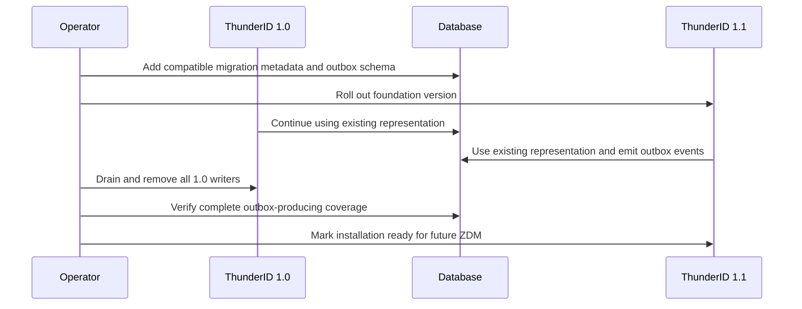
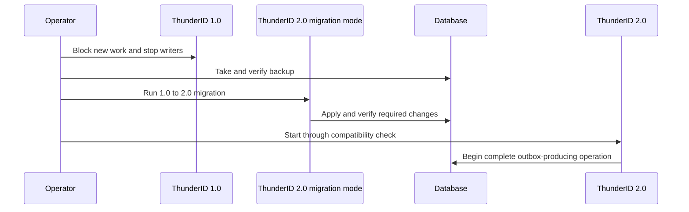

# Recommended version-upgrade migration strategy

## Status

This working strategy is superseded by
[ThunderID zero-downtime migration decision](zero-downtime-migration-final-decision.md) where the two
documents differ. It remains as supporting analysis of the version-path alternatives.

This document defines the recommended migration approaches for upgrading between ThunderID
versions. It distinguishes the bootstrap upgrade from the current 1.0 release from the
zero-downtime guarantees expected after a migration foundation has been introduced.

This is a strategy decision. Detailed migration-engine behavior and runtime-persistent outbox design
are documented separately.

Companion documents:

- [Current ZDM implementation status](zero-downtime-upgrade-current-status.md)
- [Migration upgrade overview](migration-upgrade-overview.md)
- [CDC database-copy recommendation](cdc-database-copy-migration-recommendation.md)
- [Login-only mode current state](login-only-mode-current-state.md)

## Objective

ThunderID should eventually support zero-downtime upgrades between adjacent supported releases.
The current 1.0 release does not contain all the compatibility, change-capture and migration-control
capabilities required to guarantee that outcome with minimal effort.

The strategy is therefore:

1. Treat the first upgrade from 1.0 as a bootstrap boundary.
2. Introduce the migration foundation in the next suitable release.
3. Use zero-downtime migration by default for subsequent adjacent-version upgrades.
4. Retain planned downtime as the final fallback when an online migration cannot be proven safe.

## Decision summary

| Upgrade path | Recommended approach | Guarantee |
|---|---|---|
| 1.0 to compatible foundation release | Additive rollout where verified, with planned downtime as the supported fallback | Best-effort zero downtime |
| 1.0 to immediately breaking release | Controlled downtime migration | Downtime expected |
| Foundation release to next adjacent release | In-place expand-and-contract by default | Zero downtime |
| Foundation release to next adjacent release with unsafe in-place changes | Database copy with outbox-based CDC | Zero downtime when preflight succeeds |
| Any upgrade where neither online method is safe | Controlled downtime migration | Explicit fallback |
| Multi-release jump | Walk each supported adjacent release in order | Determined per release hop |

The foundation release can be 1.1 or 2.0. The number depends on the customer-visible compatibility
impact, not only on internal database changes.

## Supported migration approaches

### Approach A: In-place expand-and-contract

This is the default zero-downtime approach after the foundation release.

The old and new ThunderID versions use the same physical database. Schema and data changes are
introduced in compatible stages:

```text
Expand schema
    |
Deploy compatible new version
    |
Backfill historical data while serving traffic
    |
Apply live delta from the transactional outbox
    |
Validate and activate the new representation
    |
Observe rollback window
    |
Contract in a later operation or release
```

Use this approach when:

- schema changes are additive;
- old and new application versions can share the expanded schema;
- the backfill can run in bounded, throttled batches;
- live changes can be captured and applied safely;
- provider-specific DDL locks are acceptable; and
- the old representation can remain available through the rollback period.

The `runtime_persistent` transactional outbox captures the delta produced during a long backfill.
Version-aware application prevents stale backfill data from overwriting newer state.

This approach avoids synchronizing two physical databases and should cover most normal upgrades.

### Approach B: Database copy with outbox-based CDC

Use a database copy when the destination must be prepared separately from the serving database.

```text
Old ThunderID writes to source database
                 |
                 | historical snapshot
                 | plus transactional outbox events
                 v
       Migration transformer and applier
                 |
                 v
New ThunderID uses destination database after cutover
```

Use this approach when:

- an in-place transformation would create unacceptable load or lock risk;
- the physical database provider or topology changes;
- the target representation is substantially incompatible;
- extensive validation is required before the new database becomes authoritative; or
- isolation from the serving database is operationally important.

The source database remains the only write authority until cutover. The migrator copies a historical
baseline, consumes the live outbox delta, transforms records, applies them idempotently, validates
the destination and drains the final delta before routing traffic to the destination.

Rollback becomes harder after the destination starts accepting writes. The cutover plan must either
provide reverse synchronization or define the point after which rollback requires downtime.

### Approach C: Controlled downtime migration

Downtime is the safety fallback when the release cannot meet the prerequisites of either online
approach.

```text
Block Control Plane changes
    |
Stop Data Plane writers
    |
Take and verify backup
    |
Run schema and data migration
    |
Validate target state
    |
Start the new ThunderID version
```

Use this approach when:

- the source release does not provide complete change capture;
- the change cannot remain compatible with the old application;
- the provider cannot perform the required DDL within the accepted availability risk;
- data cannot be transformed idempotently while writes continue;
- a safe cutover and recovery procedure cannot be demonstrated; or
- migration preflight or validation fails.

Downtime is not a migration failure. It is the explicit correctness option when zero downtime cannot
be guaranteed.

## Version path 1: 1.0 to a compatible 1.1 foundation release

This is the preferred path when breaking product changes can be postponed.

ThunderID 1.1 should focus on introducing the migration foundation while retaining compatibility
with the existing runtime-persistent representation.

### Capabilities introduced in 1.1

- database schema and migration-level metadata;
- a read-only startup compatibility check;
- an isolated Go migration command or executable;
- resumable and checkpointed backfills;
- transactional outbox coverage for all runtime-persistent mutations;
- per-consumer outbox checkpoints and retention controls;
- version-aware, idempotent transformation support;
- migration validation and reporting;
- explicit activation and cutover controls; and
- provider-specific safe DDL plans.

### Upgrade behavior



While 1.0 instances remain writable, the outbox is incomplete because those instances do not emit
events. No migration may depend on full outbox coverage during that mixed-version interval.

If the 1.1 database additions are verified as non-blocking and the application remains compatible,
a rolling deployment may be possible. The official 1.0 upgrade path must still allow a maintenance
window because 1.0 was not released with this compatibility guarantee.

After every writable instance runs 1.1, the installation has a reliable baseline for later
zero-downtime upgrades.

## Version path 2: 1.0 to an immediately breaking 2.0 release

Use this path when the next release must introduce incompatible schema, configuration, API or
operational changes that cannot be separated into a compatible foundation release.

The recommended upgrade is:



The 1.0 to 2.0 hop uses controlled downtime because 1.0 cannot provide the complete mutation stream
needed for a guaranteed online transformation. ThunderID 2.0 must include the migration foundation
so the next adjacent upgrade can be zero downtime.

Selected customers can use database-native CDC or provider-specific triggers to attempt an online
1.0 to 2.0 upgrade, but that is an advanced deployment-specific option rather than the default
ThunderID guarantee.

## Version path 3: foundation release to later adjacent releases

Once complete outbox coverage and migration controls exist, each adjacent upgrade follows this
decision order:

```text
Does the release change persisted data?
    |
    | No
    v
Rolling application upgrade

    | Yes
    v
Can the change use compatible in-place expansion?
    |
    | Yes
    v
In-place expand-and-contract with outbox delta processing

    | No
    v
Can a destination copy be synchronized and validated safely?
    |
    | Yes
    v
Database copy with outbox-based CDC

    | No
    v
Controlled downtime migration
```

The chosen approach is declared by the target release. Operators should not need to infer the method
from SQL scripts.

## Selection matrix

| Change type | Default approach | Reason |
|---|---|---|
| No persisted-data change | Rolling upgrade | No database transformation is required |
| Add table or nullable column | In-place expand-and-contract | Old and new versions can remain compatible |
| Large historical backfill | In-place plus outbox delta | Backfill and live writes can converge without copying the database |
| Replace a representation | In-place plus outbox when compatibility is possible | Old representation remains authoritative until activation |
| High-lock or physically disruptive change | Database copy plus outbox CDC | Work is isolated from the serving source |
| Change database provider | Database copy plus outbox CDC | Transformation and validation happen at the destination |
| Source release lacks required capture | Downtime, trigger or native CDC | Application outbox cannot recover unrecorded mutations |
| Unsafe destructive change | Downtime or redesigned multi-release change | Old and new versions cannot safely coexist |

## Release design rules for ZDM

Every release after the foundation must follow these rules:

1. Support upgrade from the immediately preceding published release.
2. Keep schema changes additive during the expand phase.
3. Do not remove objects required by the preceding version during a rolling upgrade.
4. Keep the old representation authoritative until migration validation succeeds.
5. Record relevant runtime-persistent mutations in the transactional outbox.
6. Make backfills restartable, idempotent and version-aware.
7. Perform activation explicitly rather than as a side effect of startup.
8. Keep destructive contraction separate from initial expansion and data movement.
9. Preserve a defined rollback observation period.
10. Declare provider-specific lock behavior and operational requirements.
11. Fail startup when the application and database migration levels are incompatible.
12. Provide preflight, progress, validation and recovery instructions for every migration.

ThunderID only needs to guarantee mixed-version compatibility for the documented adjacent release
pair. Supporting arbitrary combinations of old and new versions would make the compatibility model
unbounded.

## Logical-store treatment

Migration is selected per logical store. One release can use different approaches for different
stores.

| Store | Recommended treatment during an online upgrade |
|---|---|
| `config` | Temporarily block Control Plane mutations and keep a compatible representation available to Data Planes |
| `entitydb` | Keep writable when passkey, provisioning or lifecycle operations require it; use an online migration mechanism if its data changes |
| `runtime_transient` | Share a compatible store across versions or drain records according to TTL; do not discard active protocol state |
| `runtime_persistent` | Keep writable and use the transactional outbox for live migration delta capture |

Login-only mode is useful traffic shaping, but it is not the synchronization mechanism. It reduces
the allowed operations while login and token issuance continue. The migration plan must still handle
every write that remains possible in that mode.

## Control Plane and Data Plane responsibilities

During an online upgrade:

- the Control Plane coordinates the migration state, blocks incompatible configuration mutations,
  controls activation and initiates cutover;
- the old Data Plane continues serving from the authoritative representation;
- the migration executable performs backfill, delta processing and validation outside the request
  path; and
- the new Data Plane serves only when its database compatibility requirements are satisfied.

Migration state must not depend exclusively on a database that is currently being replaced. A
database-copy cutover needs a durable coordination record that survives source retirement.

## Upgrade guarantees

ThunderID should publish the following guarantees:

### From 1.0

- Zero downtime is attempted only when the specific migration is verified as compatible.
- Planned downtime remains the supported fallback.
- Backup and restore verification are mandatory for a destructive or incompatible migration.

### From the foundation release onward

- Adjacent-version upgrades are designed for zero downtime.
- In-place expand-and-contract is the default.
- Database copy with outbox-based CDC is the advanced online alternative.
- Downtime is used only when online preconditions cannot be met.
- Multi-release upgrades proceed through each required adjacent release.

Zero downtime remains conditional on successful preflight, sufficient database capacity, supported
provider behavior and adherence to the documented deployment procedure.

## Recommended release choice

Prefer a compatible 1.1 foundation release if breaking changes can be delayed. This creates complete
outbox coverage and migration controls before ThunderID attempts a difficult online transformation.

Choose an immediate 2.0 release when the required product changes cannot preserve compatibility.
Accept one controlled 1.0 to 2.0 maintenance migration, but include the same foundation capabilities
in 2.0 so downtime does not remain the default for future upgrades.

The decision can be summarized as:

```text
Can the next release remain compatible with the 1.0 database representation?
    |
    | Yes
    v
Release 1.1 as the migration foundation
Guarantee ZDM from 1.1 onward

    | No
    v
Release 2.0 with a controlled 1.0 migration
Guarantee ZDM from 2.0 onward
```

## Follow-up design work

The strategy requires separate implementation decisions for:

1. The release compatibility manifest and startup gate.
2. Migration state and progress schemas.
3. Runtime-persistent outbox and consumer-checkpoint schemas.
4. Aggregate event contracts for SSO, consent and revocation.
5. Backfill and validation APIs.
6. Representation activation and rollback controls.
7. Provider-specific safe DDL capabilities.
8. Database-copy cutover and post-cutover rollback.
9. Release qualification tests for mixed-version operation.
