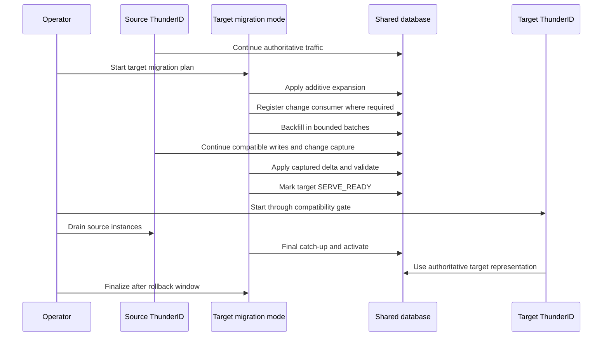

# ThunderID zero-downtime migration decision

## Status and authority

This document is the authoritative product decision for ThunderID version upgrades and database
migration. It defines the process that the migration engine and future feature migrations must
follow.

Where an earlier migration discussion or recommendation conflicts with this document, this document
wins. The earlier documents remain useful as background analysis and detailed design input.

## Final decision

ThunderID will be designed for zero-downtime migration by default after one foundation release.

The migration approach priority is:

1. In-place expand-and-contract migration.
2. Database-copy migration using snapshot plus change-data capture and blue-green deployment.
3. Controlled downtime migration as the final safety fallback.

The release immediately following the current 1.0 baseline is the foundation release. Its upgrade
will use a planned maintenance window because 1.0 does not contain the migration metadata,
compatibility contract or complete change-capture capabilities required to guarantee ZDM.

The foundation release must introduce those capabilities. Every subsequent adjacent release must be
designed and reviewed as ZDM-first. A release that requires downtime after the foundation release
needs an explicit, documented exception with technical justification.

## Product guarantee

### Upgrade to the foundation release

```text
ThunderID 1.0
    |
    | controlled downtime migration
    v
ThunderID foundation release
```

The foundation upgrade provides correctness rather than a ZDM guarantee. It is the one-time boundary
that establishes the future migration contract.

Feature developers must still author foundation-release changes using expand-and-contract rules when
those rules apply. Planned downtime is not permission to introduce unnecessarily destructive schema
changes or migration behavior that prevents later online upgrades.

### Upgrades after the foundation release

```text
Foundation release
    |
    | ZDM-first adjacent upgrade
    v
Next release
```

The default guarantee is:

> A supported adjacent ThunderID version upgrade is designed to preserve authentication and token
> traffic without a user-visible outage. In-place expand-and-contract is preferred. Database-copy CDC
> is used when in-place migration is unsafe. Controlled downtime is an approved exception, not the
> normal path.

This guarantee remains release-specific and database-provider-specific. A release can claim ZDM only
after its compatibility, locking, migration, failure-recovery and cutover behavior has been tested for
the supported provider.

ZDM by default is a guarantee for migrations that fit ThunderID's qualified migration patterns. It is
not a claim that every arbitrary schema or data transformation can run online. A migration that does
not fit a qualified pattern must use database-copy migration, an explicitly restricted operation or
the controlled-downtime exception process.

## Availability levels

ZDM does not require every administrative capability to remain available throughout every migration.
ThunderID defines two online availability levels.

### Full ZDM

All supported user, runtime and management capabilities remain available while the migration runs.

Use Full ZDM when every affected write can be handled through a compatible representation,
transactional change capture or another verified synchronization mechanism.

### Restricted ZDM

Authentication, authorization and token traffic remain available, while operations whose writes
cannot safely participate in the migration are fenced.

The minimum Restricted ZDM service contract keeps these capabilities available:

- supported authentication, authorization and token flows;
- SSO, consent, logout and revocation behavior required by those flows;
- login-critical mutations that do not invoke a fenced feature; and
- health, protocol discovery and frontend support endpoints required by those flows.

The following operations are fenced by default when their affected data is under migration:

- configuration changes;
- user registration;
- account recovery;
- JIT user provisioning;
- organization-unit creation; and
- administrative operations.

The foundation implementation exposes `operating_mode: full | restricted`. An administrator enables
restricted mode on every serving source instance and restarts those instances before migration work
that requires fencing. The migration engine does not activate or deactivate the mode automatically.
All source instances must use the same configured mode so that one instance cannot continue accepting
fenced writes.

The initial restricted mode is deliberately a stable baseline rather than a per-release migration
policy. A developer introducing another write-capable flow, executor or non-HTTP entry point is
responsible for defining and enforcing its feature gate before the first mutation.

### Writer handoff

A database-copy cutover or final in-place activation can briefly drain in-flight writers. It remains
an online migration only when requests are completed, queued or safely retried without returning an
outage to clients. A period that rejects normal authentication or token requests is downtime and must
be reported as such.

## Version support policy

Migration is defined between adjacent supported releases.

The target release owns the migration from its declared source release:

```text
Target release 2.0 contains the supported source-to-2.0 migration.
Target release 2.1 contains the supported 2.0-to-2.1 migration.
```

A later binary does not need to contain every historical migration. An installation that skips
releases follows each required adjacent migration using the owning target artifact.

Patch, minor and major releases follow the same rule. The version number does not determine whether
a database migration exists.

## Binary and execution model

The target ThunderID binary contains:

- the migration engine;
- the target release manifest;
- the ordered migration plan;
- provider-specific schema operations;
- programmatic data transformations;
- backfill and validation definitions; and
- the normal server implementation.

One compiled binary exposes isolated modes:

```text
thunderid migration initialize
thunderid migration status
thunderid migration check
thunderid migration apply
thunderid migration resume
thunderid migration activate
thunderid migration finalize

thunderid serve
```

The command names are illustrative until the command contract is implemented. The architectural
decision is that migration and serving use the same versioned product artifact but execute in
separate modes.

Migration mode can run as a Kubernetes Job, command-line process or equivalent Control Plane task
using the target release image. Request-serving replicas do not each start their own migration.

Normal startup never applies migration. It performs a read-only compatibility gate and terminates
with a precise diagnostic when any configured store is incompatible, incomplete, failed or ahead of
the binary.

### Default ZDM execution topology

The default ZDM topology uses a standalone migration process created from the target ThunderID
artifact. Target-version request-serving instances are not required to serve while migration is in
progress.

```text
Source-version instances continue serving
                 |
                 v
Target artifact runs as a standalone migration job
                 |
                 | expand, migrate, catch up and validate
                 v
Target stores become serving-compatible
                 |
                 v
Start target-version serving instances
                 |
                 v
Shift traffic and drain source-version instances
                 |
                 v
Authorize contract after the rollback boundary
```

This remains a zero-downtime upgrade because the source-version instances preserve request
availability until the target version is ready. The migration job does not open an HTTP listener and
exits after completing its requested work. The later target-serving process uses the same artifact
but initializes its own service objects.

A hosted mode in which a long-lived target-serving instance also owns a background migration
coordinator is not required for the base ZDM guarantee. It is a future optimization and must not be
a prerequisite for release migrations.

### Business services in standalone migration mode

An operation can implement its work with SQL, ThunderID business-service calls or both. SQL versus
programmatic implementation is independent of atomic versus resumable execution.

Standalone commands that execute service-dependent operations must initialize the required service
graph before constructing the executable release plan. They must not start the HTTP server or
unrelated background workers. Database-only commands and phases must not initialize normal business
services unnecessarily.

The required order is:

```text
Load static release manifest and operation declarations
                 |
                 v
Verify that prior phases reached their required boundary
                 |
                 v
Initialize services required by the selected phase
                 |
                 v
Construct runtime-bound operation instances
                 |
                 v
Execute or resume the selected phase
                 |
                 v
Persist progress, verification and store state, then exit
```

Service-based operations receive dependencies through release-specific constructors. The generic
migration engine does not import ThunderID business packages and does not require a separate
programmatic executor. A service-based operation still implements the normal `AtomicOperation` or
`ResumableOperation` contract.

For resumable work, the operation must pass the executor-provided context to every service call so
that business mutations and checkpoint updates can share the owning database transaction. The
operation developer owns batch selection, checkpoint representation, transformations, record-level
deployment scoping and the safety of external side effects. Cross-database service mutations are not
assumed to be atomic.

## Migration lifecycle

The shared lifecycle is:

```text
CURRENT
    |
    v
PREPARING
    |
    | expand, backfill, delta processing, validation
    v
SERVE_READY
    |
    | target version may enter its declared serving mode
    v
ACTIVE
    |
    | old version drained, new representation authoritative
    v
OBSERVING
    |
    | rollback observation period
    v
CONTRACT_READY
    |
    | destructive cleanup explicitly authorized
    v
COMPLETE
```

A failure moves the affected store or migration run to a durable failed or interrupted state. The
engine resumes from verified checkpoints instead of assuming that the whole release rolled back.

### Migration phase purposes

Every migration operation declares one of these phases. Operation kind and phase are independent:
schema and data operations may appear in more than one phase.

| Phase | Purpose | Typical work |
|---|---|---|
| `expand` | Prepare a representation that source and target versions can safely share. | Add compatible tables, columns and indexes; relax old constraints; install change-capture infrastructure; seed required defaults or reference data. |
| `migrate` | Move historical data and captured live changes into the target representation, then prove that it is ready. | Run bounded backfills and transformations; replay and reconcile captured changes; migrate selected deployments; validate counts and invariants. |
| `contract` | Remove the obsolete representation only after every old reader and writer is gone and rollback no longer depends on it. | Drop old tables, columns and indexes; enforce final constraints; remove compatibility or capture objects; delete temporary migration data. |

The base ZDM workflow runs `expand` and `migrate` before target traffic, then stops at
`CONTRACT_READY`. It runs `contract` only after explicit authorization. CP/DP environments may run
and verify `expand` and `migrate` separately.

Allowing target-serving instances to accept production traffic while `migrate` is still running is
not required for the base ZDM implementation. It remains a later design decision and is allowed only
when dual-read behavior or another verified compatibility rule makes partially migrated data safe.

### Meaning of completion before serving

All pre-serving operations required by the target release must complete before that release accepts
traffic. This includes required expansion, transformation, backfill, delta catch-up, validation and
compatibility recording.

This requirement does not imply that every pre-serving operation is safe while the source binary is
serving. The migration plan must explicitly identify which operations can run concurrently with the
source and which require source writers to be fenced or an isolated destination. If an operation that
must complete before target serving is not source-serving compatible, in-place ZDM is not available
for that operation unless a compatible bridge is introduced.

Destructive contraction does not run before serving when an old binary or rollback path still needs
the old representation. Contraction is a separate finalization phase executed through the same
target binary after old instances are gone and the rollback window has expired.

## Approach 1: In-place expand-and-contract

In-place migration is the default approach. Old and new ThunderID versions use the same physical
database, and migration also operates on that database.

### Required sequence



### Expand rules

The expand phase can:

- add a nullable column;
- add a column with a safe compatible default;
- add a table;
- add a provider-qualified online index;
- add a new representation alongside the old one; and
- add compatibility metadata.

The expand phase cannot:

- drop an object used by the source version;
- rename an object without a compatibility layer;
- change a column type in place when the source version cannot use it;
- reinterpret existing data in a way the source version cannot understand; or
- make the target representation authoritative before validation.

### Source-serving safety

Every migration operation must declare one of these execution classes:

| Execution class | Meaning |
|---|---|
| Source-serving compatible | The operation is qualified to run while the source binary continues serving and writing |
| Writer-fenced | Every writer to the affected representation is stopped before the operation runs |
| Isolated destination | The operation runs against a separate destination database and cannot affect the serving source database |

An operation is source-serving compatible only when both of these conditions are proven:

1. **Source-binary safety:** The schema and data remain interpretable by the source binary, and the
   operation does not introduce incompatible constraints, triggers, locks or resource pressure.
2. **Concurrent-write correctness:** Writes committed while the operation runs are captured and
   cannot be lost, duplicated, resurrected or overwritten by stale backfill data.

Ordering protects concurrent-write correctness but does not prove source-binary safety. A correctly
ordered backfill can still make authentication unavailable through blocking DDL, long transactions,
I/O saturation, transaction-log growth or a constraint that rejects source-version writes.

The engine must not start a source-serving operation merely because it is additive. Provider
qualification and the release plan must establish its lock and resource behavior. If safety cannot be
proven, the plan must use a writer fence, a compatibility bridge, database-copy migration or the
controlled-downtime path.

### Backfill and delta rules

A live backfill must be:

- bounded and checkpointed;
- restartable and idempotent;
- throttled using observed database and request-serving health;
- protected from stale overwrites;
- aware of inserts, updates and deletes; and
- verified before activation.

If source records remain writable, the migration must provide a reliable ordering or conflict rule.
This can use a domain version, a temporary migration revision or framework-managed projection state.
Timestamps alone are not a sufficient ordering mechanism.

Every live backfill must select one framework-supported conflict policy:

| Conflict policy | Use |
|---|---|
| Insert missing only | Backfill may create an absent target record but must never replace a record produced by a live write |
| Domain version | The source domain already has a meaningful monotonic version that can order changes |
| Framework-managed revision | ThunderID allocates and records mutation ordering independently of the business table |
| Writer fence | Relevant writes are stopped, so the backfill has no concurrent conflict |

A destination event ID provides deduplication but does not by itself order different changes to the
same aggregate. Framework-managed projection state records the latest applied revision, but it also
requires a reliable source revision. Where a domain version is unavailable, the common change-capture
layer must allocate the aggregate revision and append the outbox event in the same transaction as the
source mutation.

Both snapshot records and live events are applied conditionally. An incoming revision is accepted
only when it is newer than the recorded revision for the aggregate. Deletes use a tombstone or an
equivalent retained revision so that delayed snapshot data cannot recreate a deleted record.

A permanent version column is not required on every business table. Use a domain version when it has
business value. Otherwise, use shared migration or change-capture metadata. Migrations that only
insert missing target records or run with a complete writer fence do not need general revision
ordering.

### Mixed-version serving

Mixed source and target serving is allowed only when the release declares and tests a compatibility
mode. During that period:

- both versions use a mutually compatible schema;
- the source representation normally remains authoritative;
- destructive changes remain prohibited;
- old-version writes remain visible to the target version; and
- target writes remain interpretable by the source version.

The simpler valid alternative is to let the source version serve during preparation and switch
traffic to the target version only after `SERVE_READY` and final writer handoff.

### Contract rules

Contract removes old columns, tables, indexes, compatibility writes and migration-only metadata.
It runs only when:

- no source-version instance remains;
- target validation has succeeded;
- the rollback observation period has expired;
- no consumer depends on the old representation; and
- the operator explicitly authorizes finalization.

## Approach 2: Database-copy CDC with blue-green deployment

Use database-copy migration when in-place migration is unsafe or operationally unsuitable.

Examples include:

- changing database provider or cluster;
- changing region or storage topology;
- tenant split, merge or sharding;
- a physical transformation with unacceptable source locks;
- a backfill or index build that would overload the source; and
- a target requiring isolated validation before cutover.

### Required architecture

```text
Blue ThunderID
      |
Source database
      |
      | consistent snapshot plus live change stream
      v
Target binary in migration mode
      |
      | versioned transformation and idempotent application
      v
Destination database
      |
Green ThunderID
```

The default ThunderID change stream is transactional outbox to destination inbox:

```text
Source business mutation + OUTBOX_EVENT
                  |
                  | asynchronous at-least-once relay
                  v
       Destination INBOX_EVENT
                  |
                  | idempotent, version-aware processor
                  v
       Destination business representation
```

This is not a distributed transaction or synchronous cross-database dual-write. The source business
mutation and outbox event commit atomically in the source. The relay retries delivery. The destination
deduplicates by event ID and commits its mutation with destination processing state.

### Required sequence

1. Preflight source, destination, capture coverage, capacity and retention.
2. Register the migration consumer and prevent required event purging.
3. Begin buffering changes before taking the snapshot.
4. Copy a consistent historical snapshot.
5. Transform and apply snapshot records idempotently.
6. Relay source outbox events into the destination inbox.
7. Apply events using aggregate ordering and tombstones.
8. Catch up and validate destination data and domain invariants.
9. Fence and drain source writers.
10. Record and process the final source position.
11. Mark the destination `SERVE_READY`.
12. Route traffic to Green and make the destination the sole write authority.
13. Observe the rollback boundary before retiring the source.

Before cutover, only the source accepts authoritative writes. After cutover, only the destination
accepts authoritative writes. ThunderID does not provide bidirectional multi-primary replication as
part of migration.

Database-native CDC is optional. It is used when:

- the source release does not emit complete outbox events;
- external writers bypass ThunderID;
- a managed CDC service is an explicit deployment choice; or
- log-based transport is operationally preferred over outbox polling.

## Approach 3: Controlled downtime

Controlled downtime is the final correctness mechanism when neither online approach can be proven
safe.

The sequence is:

1. Fence Control Plane mutations.
2. Stop all affected Data Plane writers.
3. Take and verify a recoverable backup.
4. Run the target binary in migration mode.
5. Apply and verify schema and data transformations.
6. Record clean target migration levels.
7. Start the target version through the compatibility gate.

After the foundation release, choosing downtime requires the release migration definition to record:

- why in-place migration is unsafe;
- why database-copy CDC is unsafe or unavailable;
- affected operations and expected outage;
- backup and recovery procedure; and
- approval from the migration and product owners.

## Foundation-release requirements

The foundation release must introduce the common capabilities required by future migrations.

### Required product capabilities

1. An embedded release manifest with per-store compatibility requirements.
2. Durable migration state and progress for every participating SQL namespace.
3. A read-only startup compatibility gate.
4. One migration engine in the versioned ThunderID binary.
5. Ordered SQL and programmatic migration definitions.
6. Atomic and checkpointed operation support.
7. Store reservation, execution leases and verified resume.
8. Bounded backfill orchestration with pause, resume and throttling.
9. Validation, reporting and failure diagnostics.
10. Explicit activation and finalization controls.
11. A central feature-gating mechanism and restricted operating mode.
12. Transactional change capture and consumer checkpoints where live writes must be preserved.
13. Standard conflict policies, aggregate revision allocation and projection-state management for
    live mutable backfills.

### Required change-capture coverage

`runtime_persistent` remains writable for supported authentication and token traffic. Its migration
operations must preserve source-version writes through a compatible representation. Transactional
change capture is required only when a migration introduces a separate representation that cannot
be brought to a verified target state from the authoritative database before activation.

`entitydb` mutations that remain enabled during Restricted or Full ZDM must have a compatible
representation, change-capture or dual-representation strategy. Registration, recovery, JIT user
provisioning, organization-unit creation and administrative operations are fenced in the foundation
restricted mode.

Config DB management writes are fenced by default while Config DB data is migrated. Runtime paths
that also write Config DB must be inventoried separately from management operations. Config DB writes
required by a supported JIT provisioning flow, such as configured role assignments, need a compatible
write or change-capture path and cannot be treated as ordinary fenced management traffic.

`runtime_transient` normally uses compatible representations, versioned namespaces or TTL drain
rather than a permanent outbox. Active protocol state must not be discarded during an online
upgrade.

## Per-store default policy

| Logical store | Default online policy |
|---|---|
| `config` | Keep reads needed by supported runtime flows available; fence management writes and JIT provisioning in restricted mode |
| `entitydb` | Keep compatible login-critical mutations writable; fence registration, recovery, JIT provisioning, organization-unit creation and administrative operations |
| `runtime_transient` | Share a compatible representation or use versioned namespaces and TTL drain |
| `runtime_persistent` | Keep writable through backward-compatible schema and migration operations; add change capture only when the selected migration pattern requires it |

Migration is selected per logical store. One release can use different approaches for different
stores, coordinated by one global release plan.

Cross-store work is not assumed to be atomic. A migration that changes more than one database must
define ordering, durable intermediate states, compensation or repair behavior and final validation.

## Developer migration contract

Feature developers own the business meaning of their migration. They do not invent a custom
migration engine or orchestration algorithm.

### Developer responsibilities

For every persisted-data change, the feature developer must provide:

1. Source and target representation.
2. A selected standard migration pattern.
3. A stable migration identifier.
4. Affected logical stores, tables and deployment scopes.
5. Source and target release levels.
6. Provider-specific expand and contract operations.
7. The execution class of every operation.
8. A deterministic transformation for historical data.
9. A stable aggregate key and a selected standard conflict policy for live mutable data.
10. Insert, update and delete handling.
11. Domain validation rules.
12. Required product features and any gates needed for newly introduced write paths.
13. Mixed-version compatibility behavior.
14. Activation and rollback boundary.
15. Resource, lock and expected-duration analysis.
16. Failure, retry and resume tests.

### Framework responsibilities

The shared migration engine owns:

- plan validation and ordering;
- store reservation and concurrency control;
- transaction boundaries;
- checkpoints and verified resume;
- backfill batching and throttling;
- outbox and inbox consumption;
- at-least-once delivery and deduplication;
- aggregate revision allocation where a domain version is unavailable;
- conditional conflict-policy enforcement and tombstone handling;
- framework-managed projection state;
- retry classification;
- reusable operating-mode and feature-gate enforcement points for serving code;
- progress, metrics and reports;
- activation and finalization gates; and
- startup compatibility evidence.

Feature code must not create an independent migration worker, private progress table, custom retry
loop or uncoordinated activation switch.

This centralization is the maintenance boundary. The common framework carries the implementation,
provider qualification and operational cost of ordering and replay. Feature developers retain the
business-specific responsibility for aggregate boundaries, transformations, deletion meaning and
domain validation. ThunderID does not require revision tracking for tables whose migrations are
static, insert-missing-only or fully writer-fenced.

## Mandatory migration patterns

Every migration declares one of these patterns:

| Pattern | Use |
|---|---|
| Additive schema | Compatible table, column or index addition without data movement |
| Static backfill | Historical transformation while every relevant writer is fenced |
| Live in-place projection | Historical backfill plus captured live delta into a new representation |
| TTL drain | Versioned handling of short-lived data until the old representation expires |
| Database copy | Snapshot plus change stream into a separate destination |
| Exclusive migration | Controlled downtime after both online patterns are rejected |

Custom migration mechanics require architecture approval and must be incorporated into the shared
framework before feature use.

## Strict developer rules

The following rules are mandatory after the foundation release:

1. Design database changes for the immediately preceding version to coexist with the target version.
2. Use expand-and-contract for every change that replaces or removes a representation.
3. Do not drop, rename or incompatibly alter source-version objects during expansion.
4. Do not activate an unvalidated target representation.
5. Do not run an unbounded backfill transaction.
6. Do not use timestamps alone for conflict ordering.
7. Do not migrate a live mutable representation without capture, compatible writes or an explicit
   operation fence.
8. Represent deletes through tombstones or another verified deletion mechanism.
9. Include cleanup jobs, stored procedures and background tasks in the writer inventory.
10. Make every retryable operation idempotent.
11. Define a rollback boundary before implementation is approved.
12. Separate contraction from initial expansion and serving readiness.
13. Use the central migration engine and feature-gate system.
14. Provide implementations and tests for every supported production database provider.
15. Document any temporary reduction from Full ZDM to Restricted ZDM.
16. Preserve supported authentication, authorization and token behavior in Restricted ZDM while
    fencing incompatible auxiliary mutations.

Violating these rules is a release blocker unless the migration is explicitly approved as a downtime
exception.

## Release-level plan

Individual feature migrations are composed into one target-release plan. The plan establishes a
single global order across stores and prevents independent feature migrations from competing for
resources or activating incompatible states.

Conceptually:

```text
Target release plan
    1. Validate source release, provider capabilities and operation execution classes
    2. Reserve affected stores
    3. Apply all required expansion operations
    4. Start required change consumers
    5. Run ordered backfills and transformations
    6. Catch up captured changes
    7. Validate every affected scope
    8. Mark stores and release SERVE_READY
    9. Perform serving transition and activation
   10. Observe rollback period
   11. Finalize eligible contract operations
```

A store can become internally ready before another store, but the target release cannot serve until
every required store satisfies the release manifest.

## Restricted operating mode and feature gating

The foundation implementation combines an HTTP boundary with feature-level enforcement.

Restricted mode disables these feature identifiers:

```text
user.registration             disabled
account.recovery              disabled
administration                disabled
user.provisioning             disabled
organization_unit.creation    disabled
```

The restricted-mode middleware exposes only the HTTP endpoints required for authentication,
authorization, token operations, health checks, protocol discovery and their frontend support. It
rejects other endpoints with `feature_unavailable`. The flow service rejects registration,
user-onboarding, recovery and administration flows. Provisioning and organization-unit executors
also check their feature before their first mutation, protecting nested executor usage behind the
shared `/flow/execute` endpoint.

`full` is the default operating mode. An omitted value also preserves full access. Unsupported values
fail configuration validation. Mode changes are administrator-controlled and require all applicable
instances to be restarted with a consistent configuration.

Future improvements are intentionally outside the current scope:

- hide or disable unavailable Console functions when product requirements call for it;
- add feature identifiers and enforcement when developers introduce new write paths; and
- automate mode coordination only if a future deployment workflow requires it.

## Validation and cutover

Completing SQL statements or reaching zero event lag is not sufficient proof of migration correctness.

Every migration defines validation at three levels:

1. Structural validation, including schema objects, indexes and constraints.
2. Data validation, including counts, keys, versions, tombstones and transformed values.
3. Domain validation, including authentication, revocation, session, credential and authorization
   invariants.

Cutover requires:

- every required backfill scope completed;
- every required change consumer caught up to the declared position;
- no unresolved poison event;
- all validations passed;
- source writer ownership controlled;
- target startup compatibility satisfied; and
- a recorded rollback boundary.

## Rollback policy

Before activation, rollback normally stops the migration and leaves the source representation
authoritative.

During the observation period, rollback is allowed only while compatibility writes or another
documented reverse path keep the old representation usable.

After contract removes the old representation, rollback requires a forward repair, restoration or a
new migration. ThunderID does not promise automatic down-migration.

For database-copy migration, rollback after the destination begins accepting writes requires reverse
change capture or downtime. The release runbook must identify this point explicitly.

## Testing and enforcement

Documentation is not sufficient enforcement. Migration rules become release gates.

### Required automated tests

- source binary with expanded schema;
- target binary at every permitted migration state;
- mixed-version operation when declared;
- concurrent live writes during backfill;
- duplicate and out-of-order event delivery;
- deletion followed by stale snapshot or event application;
- crash before and after checkpoint commit;
- resume from partial progress;
- consumer lag and destination outage;
- failed validation and blocked cutover;
- restricted-mode and feature-gate enforcement before mutation;
- provider-specific DDL and lock behavior; and
- rollback before the declared boundary.

### Required review

Every persisted-data migration requires review from:

- the feature owner;
- the migration-framework owner;
- a database or persistence reviewer; and
- a security reviewer when credentials, lifecycle, sessions, consent, authorization or revocation
  are affected.

CI and plan validation must reject destructive expansion, missing provider implementations, live
backfills without a conflict strategy, source-serving operations without compatibility and resource
evidence, delete-capable migrations without deletion handling and migrations without validation or
rollback definitions.

## Production database scope

Production ZDM is qualified per database provider. PostgreSQL is the initial concrete provider in the
current product. Planned MySQL, Microsoft SQL Server and Oracle Database support must implement and
pass the same migration contracts before ZDM is claimed for them.

SQLite is not a production ZDM target. SQLite migrations still use the common version metadata and
migration definitions where practical, but they may use controlled downtime.

## Foundation implementation order

After this decision is approved, migration-engine work proceeds in this order:

1. Finalize the embedded release manifest and compatibility model.
2. Implement migration state, progress and execution leases.
3. Implement the read-only startup compatibility gate.
4. Add isolated migration commands to the ThunderID binary.
5. Implement release-plan registration and standard operation contracts.
6. Implement atomic and checkpointed execution with verified resume.
7. Add standalone service-enabled execution for migrate-phase and applicable resume operations.
8. Implement restricted operating mode and feature gating. Completed.
9. Qualify the base in-place path with a representative multi-phase migration while a restricted
   source instance continues serving authentication, authorization and token traffic.
10. Add deployment-selective data migration and durable target-aware progress for CP/DP deployments.
11. Add change capture, conflict handling and projection state only for concrete migrations whose
    writable representations require them.
12. Implement database-copy snapshot, relay, validation and cutover orchestration when that fallback
    becomes a product requirement.
13. Extend mixed-version and failure-injection qualification for each implemented migration pattern.
14. Ship the foundation release through the controlled downtime upgrade path.

## Final policy statement

ThunderID treats zero-downtime migration as a product invariant after the foundation release, not as
an optional feature added by individual teams.

Feature developers are responsible for preserving ZDM in their data-model and compatibility design.
The shared migration engine is responsible for executing those definitions consistently and safely.

In-place expand-and-contract is the normal path. Database-copy CDC with blue-green deployment is the
online fallback. Controlled downtime remains available only when the release proves that neither
online method can safely preserve correctness.
